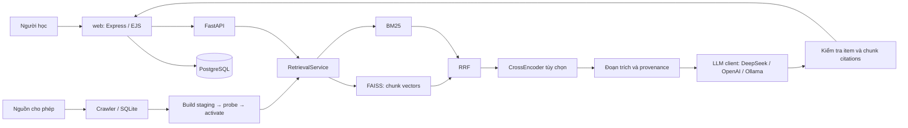

# ITLR–RAG V3

**Đồ án sinh viên: gợi ý tài nguyên học Công nghệ thông tin và chatbot trả lời dựa trên tài liệu.**

ITLR kết hợp tìm kiếm từ vựng và ngữ nghĩa, hiển thị nguồn trích dẫn và lưu hoạt động học tập.
Giao diện chính nằm trong **`web/`**, kết nối PostgreSQL và backend FastAPI. V3 là hướng phát triển
đang được kiểm chứng; mã nguồn mới không tự biến artifacts V2 đang có thành index V3.

## Mục tiêu và phạm vi

- Tìm tài liệu phù hợp với câu hỏi, loại tài nguyên và nhu cầu học.
- Truy xuất đoạn văn thay vì chỉ dựa vào vector trung bình toàn bài.
- Tách ranking, kiểm tra nguồn, generation và lưu trữ để dễ hiểu, kiểm thử, bảo trì.
- Giữ tương thích API, dữ liệu và artifacts cũ; đo kết quả thay vì tuyên bố chất lượng.

Đây không phải sản phẩm thương mại và chưa có kết luận production-ready. Không tự gán giấy phép
cho toàn đồ án. Tài liệu thu thập phải giữ nguồn, điều kiện sử dụng và bản quyền tương ứng;
xem [dữ liệu](data/README.md) và [ADR-006](docs/decisions/ADR-006-data-sources-licensing.md).

## Kiến trúc



Với artifacts V3, search, semantic chat, quick resources và off-topic dùng service chung.
BM25 + dense được hợp nhất bằng Reciprocal Rank Fusion; điểm RRF không phải xác suất.
Off-topic dùng cosine riêng, không dùng RRF để so ngưỡng. CrossEncoder chấm các passage ứng viên;
không bật mặc định trong thử nghiệm CPU local. Generation V3 yêu cầu cite `[item_id:ID]` và
`[chunk_id:ID:INDEX]` thuộc evidence đã chọn. Kiểm tra ID không chứng minh nội dung được nguồn hỗ trợ.

Artifacts V2 vẫn hoạt động qua đường tương thích. Các template/intent học tập và CF có chức năng
riêng; không được báo cáo template như kết quả LLM có groundedness đã xác minh.

## Công nghệ và cấu trúc

| Thành phần | Công nghệ / trách nhiệm |
|---|---|
| Giao diện chính | Express, TypeScript, EJS; auth, học tập, hội thoại |
| Lưu trữ web | PostgreSQL; tài khoản, tiến độ, nội dung và hội thoại |
| API | Python, FastAPI, Pydantic |
| Retrieval | E5, FAISS, BM25, TF-IDF tương thích, RRF, optional CrossEncoder |
| Generation | OpenAI-compatible SDK và Ollama; chỉ generation dùng LLM |
| Ingestion | httpx, BeautifulSoup, feedparser, robots và SQLite |
| Kiểm thử | pytest, Vitest; GitHub Actions |

```text
itlr/
  api/           FastAPI và UI tĩnh phụ
  retrieval/     service dùng chung, BM25
  core/          chunk FAISS, ANN, reranking, thuật toán tương thích
  chatbot/       routing, nguồn trích dẫn, LLM client
  collect/       crawler và SQLite
  pipelines/     build artifacts và CF
  eval/          metrics và đánh giá dùng lại
web/src/         Express, EJS, TypeScript, SQL và static assets
scripts/         CLI thu thập, build, refresh, export catalog
eval/           entrypoint benchmark và evaluation
tests/          Python regression và integration
configs/         cấu hình nguồn và dữ liệu curated
deploy/         hướng dẫn local, Docker, timer
docs/decisions/ ADR và quyết định kiến trúc
reports/        kết quả có provenance, gồm báo cáo lịch sử
```

## Cài đặt

Yêu cầu: Python ≥3.11, Node.js 22, PostgreSQL và đủ RAM cho model CPU. Môi trường đã dùng
Python 3.14.3; phiên bản tối thiểu không đảm bảo mọi wheel neural có sẵn trên mọi hệ điều hành.

```bash
python3 -m venv .venv
.venv/bin/python -m pip install -r requirements.txt
cd web
npm ci
cp .env.example .env
```

Điền `web/.env`: `DATABASE_URL`, `JWT_SECRET` ngẫu nhiên ≥32 ký tự, `ADMIN_PASSCODE` ≥16 ký tự,
`PORT=3000`, `RECOMMENDER_URL=http://127.0.0.1:8000`, `APP_ORIGIN=http://localhost:3000`.
Không dùng credentials mẫu, không commit `.env`. Tạo database PostgreSQL riêng cho đồ án trước
khi áp schema; không trỏ migration/seed vào database không thuộc dự án.

Từ `web/`, sau khi database đã sẵn sàng:

```bash
npm run migrate
npm run seed
npm run dev
```

Seed cần `var/data/web_items.csv`; tạo catalog từ index đang active ở repo root:

```bash
.venv/bin/python scripts/export_web_catalog.py
```

Mở **http://localhost:3000**, đăng ký hoặc đăng nhập. Backend phải chạy song song ở cổng 8000.
`npm run build` biên dịch TypeScript và copy views/public/schema vào `dist/`; sau đó chạy
`npm start`. Dockerfile tái sử dụng cùng lệnh build để tránh hai quy trình copy khác nhau.

## Chạy backend và model local

Xem [hướng dẫn E5/Qwen](deploy/LOCAL_MODELS.md) cho cache và Ollama đã cài. Lệnh tối thiểu ở repo root:

```bash
env -u DEEPSEEK_API_KEY -u OPENAI_API_KEY \
  HF_HOME="$PWD/var/hf" HF_HUB_OFFLINE=1 TRANSFORMERS_OFFLINE=1 \
  USE_OLLAMA=1 OLLAMA_MODEL=qwen2.5:3b DISABLE_RERANKER=1 \
  OMP_NUM_THREADS=4 MKL_NUM_THREADS=4 ITLR_REQUIRE_ARTIFACT_MANIFEST=1 \
  .venv/bin/python -m uvicorn itlr.api.server:app --host 127.0.0.1 --port 8000 \
  --workers 1 --no-proxy-headers
```

Cần index đã build và Ollama đang chạy. Nếu không dùng Ollama, đặt `USE_OLLAMA=0` để thử đường
extractive/template; không gán nhãn đây là benchmark generation LLM. DeepSeek chỉ gọi khi đã
được phép và có key môi trường; model/base URL cấu hình trong `llm_client.py`, cần kiểm tra provider
trước khi dùng. Bảng giá trong code là ước tính, không phải báo giá chính thức.

## Dữ liệu và workflow cập nhật

```bash
.venv/bin/python scripts/collect_data.py
.venv/bin/python scripts/build_all_v2.py --real-only --no-activate
.venv/bin/python scripts/refresh_pipeline.py --no-build
```

Tên CLI V2 được giữ tương thích; builder mới lưu thêm chunk vectors cho V3. Lần đầu tải model cần
`--online`, có mạng và thời gian build. Xem [deployment](deploy/DEPLOY.md) trước khi activate/rollback;
không chạy build thay đổi index đang sử dụng chỉ để thử giao diện. `CURRENT.json` chứa pointer và
history atomic; file history riêng là mirror tương thích. Sau lỗi ghi mirror phải kiểm tra pointer
trước khi retry. Khóa hiện dành cho tiến trình hợp tác trên Linux local, không phải distributed lock.

Catalog legacy 5.000 items và interactions CF là **synthetic**. Snapshot tài liệu thật có provenance;
index local đã quan sát có 118 items, không suy ra tất cả bản checkout có cùng số lượng.
Rolling feed mặc định không được dùng sự vắng mặt để đánh dấu bài đã bị xóa.

## API chính

| Endpoint backend | Chức năng |
|---|---|
| `GET /health` | Readiness engine, số item, trạng thái CF |
| `GET /live` | Liveness |
| `POST /api/search` | `query`, `min_pct`, `item_type` tùy chọn |
| `POST /api/chat` | `message`, `history` |
| `POST /api/chat/stream` | SSE, sources trước token, kết quả final có kiểm tra citation |
| `GET /api/personas` | Personas synthetic khi CF có model |
| `POST /api/for-you` | Gợi ý CF; thiếu model trả 503 |
| `POST /admin/reload` | Cần `X-Admin-Token`; nạp mới rồi mới hoán đổi |

Xem schema thực tế tại http://127.0.0.1:8000/docs. Web có `/ready` kiểm tra kết nối database.
Cổng 8000 không thay thế giao diện chính trong `web/`.

## Kiểm thử và đánh giá

```bash
USE_OLLAMA=0 DISABLE_RERANKER=1 OMP_NUM_THREADS=1 MKL_NUM_THREADS=1 OPENBLAS_NUM_THREADS=1 \
  .venv/bin/python -m pytest tests/ -o addopts='' -q -ra
.venv/bin/python -m compileall -q itlr scripts eval
.venv/bin/python eval/bench_chunks_v3.py
cd web
npm run typecheck
npm run lint
npm run build
npm test
```

[Validation](reports/VALIDATION.md) chứa kết quả mới nhất. Checkpoint trước phiên này: 256 Python
pass/0 skip, 59 Web pass, lint 0 lỗi/20 cảnh báo; không dùng số này thay cho execution mới.
GitHub Actions kiểm tra Python, Web, dependencies và PostgreSQL integration theo workflow.

| Thử nghiệm có thật | Kết quả và giới hạn |
|---|---|
| E5 CPU, 8 snapshot/98 chunk, 8 item qrels tự soạn | V2 mean dense và V3 chunk hybrid cùng Recall@5/MRR@5/nDCG@5=1,0 |
| Cùng thử nghiệm | p95 129,07/130,23 ms; CPU 113,98/114,98 ms/query; peak RSS toàn process 1468,86 MiB |
| Faithfulness/hallucination/citation accuracy | Chưa đo generation trong thử nghiệm này; giá trị null |
| Nhãn “human” mô phỏng ở báo cáo cũ | Không phải hội đồng gán nhãn/người dùng thật |

Số từ [raw JSON](reports/chunks_v3_unified_experiment.json) là bộ nhỏ dễ, không chứng minh V3 tốt
hoặc nhanh hơn trên toàn corpus. Qrels metadata/rule-based và đánh giá ID không thay cho nhãn
passage độc lập và kiểm tra semantic entailment. Báo cáo lịch sử vẫn được giữ, có nhãn thời điểm.

## Giới hạn và hướng phát triển

- Index đang active có thể là V2; cần build/probe và đánh giá trước khi chuyển V3.
- Chưa có kiểm chứng đầy đủ CrossEncoder thật, DeepSeek live được phép, full-corpus quality/load.
- PostgreSQL readiness và trang login đã thử local; không đồng nghĩa toàn bộ DB/browser E2E pass.
- Docker Compose và mất điện/storage vật lý chưa được kiểm chứng; test process crash có phạm vi hẹp hơn.
- Tối ưu corpus lớn, cache embeddings, nhãn passage thật và faithfulness là các bước tiếp theo.
- Giữ [sàn chất lượng](CONSTRAINTS.md), không bỏ tests để đạt PASS.

Tham khảo [ADR-010](docs/decisions/ADR-010-shared-retrieval-and-atomic-state.md),
[báo cáo V3](reports/V3_RESTRUCTURING_2026-10-30.md) và [changelog](CHANGELOG.md).
