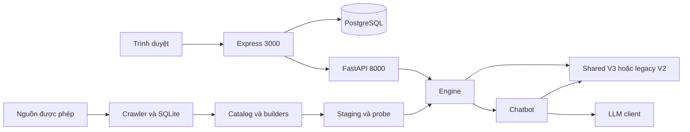

# ITLR–RAG | Intelligent IT Learning Platform

## Tổng quan sản phẩm (Product Overview)

ITLR–RAG hỗ trợ học Công nghệ thông tin bằng tiếng Việt: tìm tài nguyên, hỏi đáp theo tài liệu, xây lộ trình và theo dõi tiến độ. Web Express + TypeScript + EJS tại cổng 3000 quản lý trải nghiệm người dùng; FastAPI tại cổng 8000 cung cấp retrieval, chatbot và gợi ý tài nguyên.

Repository đang được phát triển; kết quả từng checkpoint và phạm vi kiểm chứng xem [validation](reports/VALIDATION.md). Chưa đủ bằng chứng để xác nhận production-ready.

Release validation Linux: **445 Python PASS/0 skip, 145 Web PASS**; coverage
Python statements **66,70%**, Web lines **46,55%**. Native PostgreSQL18/backup/restore
và Chrome DB journeys đã chạy trên fixtures cô lập; Docker production chưa chạy.
[Kết quả, bằng chứng và NO-GO](reports/RELEASE_READINESS_FINAL.md).
[Full-system audit trước](reports/FULL_SYSTEM_AUDIT_2026-10-30.md) được giữ nguyên.

Search mặc định `min_pct=84` (cosine 0,84); truyền `min_pct=90` để giữ floor cũ.
Raw retrieval Recall@5 trên 23 frozen queries tăng 4,76% → 92,86%; holdout end-to-end
83,33%, tập xác nhận 62,50%, nhãn engineer-authored chưa độc lập. Các tập đo giữ
negative rejection, chưa chứng minh precision/faithfulness production. Qwen vẫn có
thể sai nội dung hoặc không hoàn tất; bộ mới source-disjoint đạt Recall@5 83,33%
(12 positives/8 negatives, fresh AI author, chưa phải human panel). Suite xanh không
thay kiểm chứng generation, cancellation upstream và deployment production.

## Khả năng (Features)

- Tìm khóa học/tài liệu bằng lexical và semantic retrieval; V3 truy xuất chunk, artifacts cũ giữ đường V2.
- Chatbot có intent/template và generation qua DeepSeek, OpenAI hoặc Ollama. Nguồn trích dẫn giúp kiểm tra evidence; citation identity chưa chứng minh faithfulness.
- Tài khoản, hội thoại, tiến độ, luồng học tập và tương tác cộng đồng lưu trong PostgreSQL.
- Crawler có policy quyền sử dụng, robots/rate-limit, chuẩn hóa URL, deduplication và provenance; ingestion offline dùng SQLite.
- Artifact staging, probe, activation, reload và rollback theo version.
- Collaborative Filtering tùy chọn; interactions hiện có là synthetic, chưa chứng minh hiệu quả cá nhân hóa trên người dùng thật.

## Kiến trúc (Architecture)



[Bản đồ module](docs/ARCHITECTURE.md) mô tả trách nhiệm, dependency direction và lifecycle. Retrieval độc lập với SDK generation và phiên Web. Không đổi tên shim `itlr/core/bm25.py`: pickle cũ còn tham chiếu đường dẫn này.

## Khởi chạy local (Quickstart)

Cần Python ≥3.11, Node.js 22 và PostgreSQL. Các lệnh Bash dưới đây chạy từ repo root; trên Windows dùng `.venv/Scripts/python.exe`, `npm.cmd` nếu PowerShell chặn npm.ps1, đồng thời đặt `PYTHONUTF8=1` và `PYTHONIOENCODING=utf-8`.

```bash
python3 -m venv .venv
.venv/bin/python -m pip install -r requirements.txt
cd web
npm ci
cp .env.example .env
```

Điền credentials riêng trong `web/.env`: `DATABASE_URL`, `JWT_SECRET` ≥32 ký tự, `ADMIN_PASSCODE` ≥16 ký tự; đặt `APP_ORIGIN=http://localhost:3000`, `RECOMMENDER_URL=http://127.0.0.1:8000`.

Backend cần model cache và artifacts đã build/probe. Máy mới làm theo [chuẩn bị dữ liệu/index](deploy/DEPLOY.md#chuẩn-bị-dữ-liệu-và-index); máy có cache đọc [model local](deploy/LOCAL_MODELS.md). Không rebuild artifacts đang phục vụ để thử giao diện.

Khi database local cô lập và catalog Web đã chuẩn bị, chạy trong `web/`:

```bash
npm run migrate
npm run seed
npm run dev
```

Migration và seed **ghi database**, chỉ chạy với database đích đã kiểm tra. Seed cần `var/data/web_items.csv`; exporter từ chối ghi đè file đã tồn tại. Quy trình export/sync xem [deployment](deploy/DEPLOY.md). Mở **http://localhost:3000** khi API chạy song song.

Từ repo root, với artifacts/model cache có sẵn, chạy API không gọi provider trả phí:

```bash
env -u DEEPSEEK_API_KEY -u OPENAI_API_KEY \
  USE_OLLAMA=0 DISABLE_RERANKER=1 HF_HUB_OFFLINE=1 TRANSFORMERS_OFFLINE=1 \
  .venv/bin/python -m uvicorn itlr.api.server:app \
  --host 127.0.0.1 --port 8000 --workers 1 --no-proxy-headers
```

Root `.env.example` là tài liệu cấu hình; lệnh Python không tự nạp mọi file `.env`. Thiếu artifacts/model làm API chưa ready; không dùng dữ liệu synthetic làm fallback mà gắn nhãn dữ liệu thật.

## Cấu hình (Configuration)

| Phạm vi | Cấu hình |
|---|---|
| Python paths | `itlr/config.py`; `ITLR_ARTIFACTS_DIR`, `ITLR_ITEMS_CSV`, `ITLR_INTERACTIONS_CSV` |
| Generation | `DEEPSEEK_API_KEY`, `DEEPSEEK_MODEL`, `DEEPSEEK_BASE_URL`; dự phòng `OPENAI_API_KEY`, `USE_OLLAMA`, `OLLAMA_*` |
| API admin | `ITLR_ADMIN_TOKEN`; thiếu/rỗng trả 403 tại reload |
| Web | `web/src/config/env.ts`; database, secrets, origin và URL backend |
| Deployment | `deploy/*.env.example`, một worker/replica mỗi service |

Danh mục chi tiết và giá trị mặc định: [cấu hình vận hành](deploy/DEPLOY.md#cấu-hình). Secrets giữ ngoài Git; không đưa key hoặc reset token vào log/report. Giá/model của provider trong code là cấu hình/ước tính, cần kiểm tra riêng khi được phép gọi thật.

## Phát triển (Development)

- Web composition ở `app.ts`; socket và shutdown ở `server.ts`. Chat HTTP handlers ở `routes/chat.handlers.ts`.
- `itlr/chatbot/llm_adapter.py` sở hữu history/fallback adaptation; transport generation ở `llm_client.py`.
- `itlr/core/display.py` định dạng catalog khi hiển thị; không tham gia ranking. Export cũ từ recommender và chatbot vẫn được giữ.
- Giữ API, schema, pickle paths, V2/V3 và SSE contracts. Đọc [AGENTS](AGENTS.md) và [CONSTRAINTS](CONSTRAINTS.md) trước khi sửa.
- Bug cần regression FAIL → fix → PASS. Không tự commit/push, chạy migration production hoặc thay dữ liệu runtime.

## Kiểm chứng (Testing)

```bash
env -u DEEPSEEK_API_KEY -u OPENAI_API_KEY \
  USE_OLLAMA=0 DISABLE_RERANKER=1 OMP_NUM_THREADS=1 MKL_NUM_THREADS=1 OPENBLAS_NUM_THREADS=1 \
  .venv/bin/python -m pytest tests/ -o addopts='' -q -ra
.venv/bin/python -m compileall -q itlr scripts eval
.venv/bin/python -m pip check
cd web
npm run typecheck
npm run lint
npm run build
npm test
```

Các test dùng fixture/model giả không chứng minh chất lượng neural hoặc provider live. Đánh giá offline: `eval/run_all.py --quick` ghi outputs vào reports; chỉ chạy có chủ đích. `eval/eval_generation.py --llm` yêu cầu provider và quyền gọi API trả phí nếu có. Chỉ tiêu chưa đo phải giữ `null`; nhãn metadata/synthetic không được trình bày như human labels.

Release diagnostics trên 118 snapshot thật và 23 truy vấn, có tiếng Việt/nhiễu/nhiều bước:
`.venv/bin/python eval/eval_release_retrieval.py --repeats 5 --out reports/release-retrieval.json`.
Qrels có evidence nhưng là engineer-authored, chưa phải independent human evaluation.
Đây là so sánh lexical/MMR; chưa đo neural V3, CrossEncoder hoặc generation.

## Triển khai (Deployment)

[DEPLOY](deploy/DEPLOY.md) mô tả cài đặt, cấu hình và index lifecycle.
[Production runbook](deploy/PRODUCTION.md) mô tả Compose/Caddy, staging, migration, monitoring, backup/restore và rollback.
Một host Linux, local filesystem, một worker/replica mỗi service là giới hạn hiện hành. Docker/Web restart không tự migrate hoặc seed.

API: `GET /live` là liveness; `GET /health` trả readiness, số items và trạng thái CF,
chưa công khai version/hash của engine đã nạp. CURRENT.json/manifest chỉ là trạng thái
filesystem. Web: `GET /health` là liveness, `GET /ready` kiểm PostgreSQL. OpenAPI ở `/docs`.

API chính: `POST /api/search`, `POST /api/chat`, `POST /api/chat/stream`, `GET /api/personas`, `POST /api/for-you`. CF thiếu model trả 503. `POST /admin/reload` yêu cầu `X-Admin-Token` khớp cấu hình.

SSE text là provisional; `final` mới là kết quả thay thế đã qua xử lý. `done` chỉ kết thúc stream, không chứng minh thành công.

Web từ chối event sau `done`. Client generation từ chối kết thúc bị cắt/filtered/tool-call;
Ollama cần terminal `done` hợp lệ. Lỗi partial không được dùng làm final thành công.
Provider được chọn theo cấu hình lúc bắt đầu; lỗi provider không tự chuyển sang cloud
provider khác. Adapter dùng template/error final theo contract.
Legacy OpenAI-compatible stream thiếu finish metadata vẫn được chấp nhận nhưng log
WARNING `completion unverified`; không coi đó là bằng chứng completion toàn vẹn.

## Giới hạn đã biết (Known Limitations)

- Chưa xác nhận Docker/PostgreSQL/HTTPS staging, authenticated E2E, backup/restore hoặc recovery trên storage production.
- Chưa có đánh giá độc lập đủ rộng về neural retrieval, CrossEncoder, faithfulness, hallucination và refusal.
- Usage/cost tracker hiện ghi cho non-stream completions; streaming usage/cost chưa được đo đầy đủ.
- Catalog legacy 5.000 items và interactions CF là synthetic; snapshot curated chứa 118 trang thật. `/health` cung cấp số items runtime; provenance cần đối chiếu riêng với release/artifact manifest tin cậy.
- CSV catalog, PostgreSQL và artifact activation chưa có transaction xuyên hệ thống; release cần maintenance window.
- Pickle chỉ từ builder tin cậy. SHA256 inventory không xác nhận tác giả nếu attacker sửa được cả file và manifest.
- Chẩn đoán học tập bằng luật chưa được xác nhận là phép đo năng lực; local locks/rate limiter RAM chưa hỗ trợ nhiều host.
- Không tự gán giấy phép chung cho repository. Giữ license/attribution từng nguồn theo [data README](data/README.md).

## Điều hướng tài liệu

| Nhu cầu | Tài liệu |
|---|---|
| Kiến trúc và quyết định | [Architecture](docs/ARCHITECTURE.md), [ADR-010](docs/decisions/ADR-010-shared-retrieval-and-atomic-state.md) |
| Trạng thái và bằng chứng mới | [Memory](docs/PROJECT_MEMORY.md), [Validation](reports/VALIDATION.md) |
| Kiểm kê code/tài liệu và Before/After | [Restructuring report](reports/RESTRUCTURING_CONTINUATION_2026-10-30.md) |
| Lịch sử thay đổi | [Changelog](CHANGELOG.md) |
| Dữ liệu và phương pháp đánh giá | [Data](data/README.md), [ADR-004](docs/decisions/ADR-004-evaluation-design.md), [nghiên cứu nền](RESEARCH_ITLR.md) |
| Công việc chưa hoàn tất | [Checklist](tasks/todo.md), [kế hoạch lịch sử](tasks/plan.md) |
