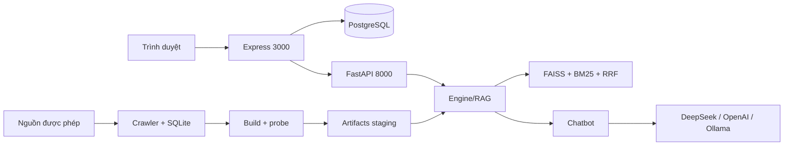

# ITLR–RAG | Intelligent IT Learning Platform

Nền tảng học CNTT tiếng Việt: tìm tài nguyên (khóa học, tài liệu), hỏi đáp RAG có trích dẫn
nguyên văn từ nguồn, theo dõi lộ trình và tiến độ, và các tính năng cộng đồng. Hệ thống gồm
giao diện Express/TypeScript/EJS (cổng 3000), backend FastAPI (cổng 8000) và PostgreSQL.

**Trạng thái phát hành: NO-GO cho production.** Staging single-host đã chạy thật (Docker,
PostgreSQL 16, Caddy TLS nội bộ, E5, Qwen2.5:3b, Chrome). Hai blocker còn mở: CPU-only
không đạt SLO 45 giây cho prompt uncached, và human faithfulness chưa có người chấm
(`null`). Chi tiết: [certification](reports/FINAL_E2E_CERTIFICATION.md) ·
[validation](reports/VALIDATION.md).

## Năng lực

- **Tìm kiếm lai**: FAISS inner-product trên embedding E5-base (768d), BM25, hợp nhất RRF,
  reranker CrossEncoder (bật mặc định, tắt bằng `DISABLE_RERANKER=1`); ngưỡng mặc định `min_pct=84`.
- **Chat có bằng chứng**: model chỉ chọn chunk ID (JSON), engine bind câu trả lời nguyên văn
  từ excerpt đã lưu (`llm_extractive`); citation được kiểm id và byte-verbatim; thiếu bằng
  chứng thì từ chối thay vì sinh claim tự do.
- **Nguồn và provenance**: crawler có robots/rate limit, kiểm giấy phép từng nguồn, lưu
  license/attribution; snapshot curated 118 trang thật trong repo.
- **Vòng đời index**: build staging → probe → activate nguyên tử → `/admin/reload` → rollback;
  fingerprint artifacts đã nạp hiển thị ở `/health`.
- **Ứng dụng Web**: tài khoản, hội thoại SSE, tiến độ khóa học, tài liệu đính kèm có kiểm
  chữ ký, diễn đàn, khu quản trị, CSRF, rate limit RAM, một worker/replica mỗi service.

## Kiến trúc



Chi tiết thành phần, ranh giới module và trade-off: [ARCHITECTURE](docs/ARCHITECTURE.md).
Luồng RAG, citation và fallback: [RAG](docs/RAG.md).

## Bắt đầu nhanh (local)

Yêu cầu: Python ≥3.11 (đã kiểm chứng với 3.14.4), Node.js 22, PostgreSQL, artifacts và
model cache đã chuẩn bị. Một checkout mới không tự có `var/`, model hay database.

```bash
python3 -m venv .venv
.venv/bin/python -m pip install -r requirements.txt
cd web && npm ci && cp .env.example .env
```

Điền `web/.env` (database, `JWT_SECRET` ≥32 ký tự, `ADMIN_PASSCODE` ≥16 ký tự,
`APP_ORIGIN`, `RECOMMENDER_URL`). Sau đó, từ `web/`:

```bash
npm run migrate
npm run seed      # cần var/data/web_items.csv
npm run dev
```

API chạy song song, không gọi provider trả phí nếu thiếu key:

```bash
env -u DEEPSEEK_API_KEY -u OPENAI_API_KEY \
  USE_OLLAMA=0 DISABLE_RERANKER=1 HF_HUB_OFFLINE=1 TRANSFORMERS_OFFLINE=1 \
  .venv/bin/python -m uvicorn itlr.api.server:app \
  --host 127.0.0.1 --port 8000 --workers 1 --no-proxy-headers
```

Migration/seed **ghi database**; chỉ chạy với database đích đã kiểm tra. Chuẩn bị dữ liệu,
build index và chạy với model local: [DEPLOY](deploy/DEPLOY.md),
[LOCAL_MODELS](deploy/LOCAL_MODELS.md). HTTPS/Compose một host: [PRODUCTION](deploy/PRODUCTION.md).

## Cấu hình

Cấu hình Python đi qua `itlr/config.py` (paths) và biến môi trường của process; Web đọc
`web/.env` qua `web/src/config/env.ts`. Bảng biến đầy đủ và giá trị mặc định nằm ở
[DEPLOY §Cấu hình](deploy/DEPLOY.md#cấu-hình); không lặp lại trong README để tránh lệch.

Nguyên tắc: secrets chỉ trong môi trường hoặc file local bị gitignore; `.env.example`
chứa giá trị rỗng; không đưa key/reset token vào log hay báo cáo.

## Luồng công việc chính

1. **Nạp dữ liệu** — import snapshot curated hoặc crawl có kiểm soát → SQLite + metadata.
2. **Build/probe** — `scripts/build_all_v2.py --real-only --no-activate` tạo version mới trong
   staging, probe cấu trúc/dimension/NaN/self-retrieval, ghi `MANIFEST.json`.
3. **Activate/reload** — activate version đã probe, `POST /admin/reload` với `X-Admin-Token`;
   `/health` trả fingerprint `version` + `manifest_sha256` của engine đang phục vụ.
4. **Đồng bộ catalog Web** — export CSV từ index active → `npm run sync` (upsert, không xóa
   enrollment). Không có transaction xuyên Python/PostgreSQL.
5. **Rollback** — `versioning.rollback()` + reload; backup/restore PostgreSQL theo
   [PRODUCTION](deploy/PRODUCTION.md).

## Kiểm chứng

```bash
env -u DEEPSEEK_API_KEY -u OPENAI_API_KEY \
  USE_OLLAMA=0 DISABLE_RERANKER=1 OMP_NUM_THREADS=1 MKL_NUM_THREADS=1 OPENBLAS_NUM_THREADS=1 \
  .venv/bin/python -m pytest tests/ -o addopts='' -q -ra
.venv/bin/python -m compileall -q itlr scripts eval
.venv/bin/python -m pip check
cd web && npm run typecheck && npm run lint && npm run build && npm test
```

Kết quả mới nhất (máy Linux, commit `f14c428`, không thay đổi code runtime): **494 Python PASS/0 skip**, coverage
statements **67,63%**; **162 Web PASS**, line coverage **51,42%**; typecheck/lint/build,
compileall, pip check PASS; pip-audit **0**, npm audit **0**, Bandit **0 High**. Docker staging
fresh `--no-cache` + Chrome **11/11** PASS trong phạm vi single-host. Phương pháp, coverage và
giới hạn: [TESTING](docs/TESTING.md) · [EVALUATION](docs/EVALUATION.md).

## Triển khai

| Môi trường | Tài liệu |
|---|---|
| Local (dev) | [DEPLOY](deploy/DEPLOY.md) |
| Model E5/Qwen local | [LOCAL_MODELS](deploy/LOCAL_MODELS.md) |
| Single-host HTTPS (Caddy + Compose) | [PRODUCTION](deploy/PRODUCTION.md) |

Giới hạn hạ tầng hiện hành: một host Linux, local filesystem, một worker/replica mỗi
service; limiter/presence trong RAM và khóa file chưa hỗ trợ nhiều host. Restart container
không tự migrate/seed.

## Giới hạn đã biết

- **SLO 45s**: Qwen2.5:3b trên CPU này prefill 40–51s cho prompt 1387 token; nén prompt
  500/800 chars làm giảm chất lượng theo case nên default giữ `None`. Cần prefill
  ≥65–70 tok/s (CPU mới hoặc GPU) và phải chạy lại frozen + cold/warm.
- **Human faithfulness/entailment** chưa đo (`null`); packet và protocol chấm đã sẵn sàng.
- Capacity/soak dài, cold concurrency >1, multi-host/HA, migration production **chưa
  kiểm chứng**.
- Catalog legacy 5.000 items và interactions CF là **synthetic**; snapshot thật là 118 trang.
  Qrels hiện có là metadata/rule-based hoặc engineer-authored, không phải human panel.
- Citation hợp lệ/verbatim không chứng minh entailment; chỉ tiêu chưa đo phải `null`.
- Pickle chỉ nạp từ builder tin cậy; SHA256 không chống được attacker sửa cả file và manifest.
- Không gán giấy phép cho repository; giữ license/attribution từng nguồn theo
  [data README](data/README.md).

## Điều hướng tài liệu

| Nhu cầu | Tài liệu |
|---|---|
| Kiến trúc, ranh giới, trade-off | [docs/ARCHITECTURE.md](docs/ARCHITECTURE.md) |
| Truy hồi, generation, citation, fallback | [docs/RAG.md](docs/RAG.md) |
| HTTP API và route Web | [docs/API.md](docs/API.md) |
| Test, coverage, chiến lược kiểm chứng | [docs/TESTING.md](docs/TESTING.md) |
| Metric, dataset, nguồn nhãn, giới hạn | [docs/EVALUATION.md](docs/EVALUATION.md) |
| Bảo mật, trust boundary, scan | [docs/SECURITY.md](docs/SECURITY.md) |
| Quyết định kiến trúc | [ADR](docs/decisions/ADR-001-deepseek-primary-llm.md) (001–013) |
| Trạng thái & evidence mới nhất | [PROJECT_MEMORY](docs/PROJECT_MEMORY.md), [VALIDATION](reports/VALIDATION.md), [certification](reports/FINAL_E2E_CERTIFICATION.md), [code freeze](reports/FINAL_CODEBASE_FREEZE.md), [maintainability](reports/FINAL_MAINTAINABILITY_REVIEW.md) |
| Quy ước cho coding agent | [AGENTS](AGENTS.md), [CONSTRAINTS](CONSTRAINTS.md) |
| Lịch sử thay đổi | [CHANGELOG](CHANGELOG.md) |
| Lưu trữ (không phải trạng thái hiện hành) | [reports/](reports/), [review 2026-10-27](docs/review-2026-10-27.md), [nghiên cứu nền 2026-10-27](RESEARCH_ITLR.md), [kế hoạch](tasks/plan.md) |
