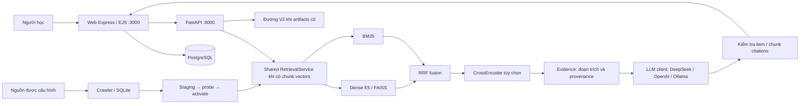

# ITLR–RAG | Intelligent IT Learning Platform

Lượt kiểm chứng mới nhất: **384 Python PASS/0 skip** (coverage 64,96%), **124 Web PASS/0 skip** (lines 45,01%), lint 0 warning, Bandit 0 High; release verdict vẫn **NOT READY** vì Docker/PostgreSQL/HTTPS và neural/human evaluation chưa chạy. Xem [bằng chứng mới](reports/AUDIT_PORTABILITY_2026-10-30.md).

Checkpoint trước (lịch sử): **329 Python tests pass/0 skip**,
**78 Web tests pass**; typecheck/lint/build và dependency audits đã chạy. Xem
[báo cáo increment](reports/AUDIT_INCREMENT_2026-10-30.md) cho regression, giới hạn
benchmark và phần audit còn lại. Không coi đây là hoàn tất production readiness.

Current refactoring evidence and limits: [architecture checkpoint](reports/ARCHITECTURE_REFACTOR_2026-10-30.md).
Offline answer formatting is owned by `itlr/chatbot/presentation.py`; Web upload
append and PostgreSQL sync share `web/src/services/catalog-csv.ts` for legacy and
provenance catalog columns. Existing chatbot helper imports remain compatible.

Deployment configuration for the full single-host stack: [production runbook](deploy/PRODUCTION.md). Web startup now requires explicit migration/catalog sync before serving traffic.

ITLR–RAG là nền tảng hỗ trợ học Công nghệ thông tin bằng tiếng Việt: tìm tài nguyên, hỏi đáp theo tài liệu, xây lộ trình và theo dõi tiến độ. Giao diện chính dùng Express, TypeScript, EJS và PostgreSQL tại cổng 3000; backend FastAPI tại cổng 8000 cung cấp retrieval, chatbot và gợi ý tài nguyên.

Hệ thống kết hợp tìm kiếm từ vựng với ngữ nghĩa và trình bày nguồn trích dẫn để người học kiểm tra. Mã V3 hỗ trợ truy xuất ở mức chunk; artifacts cũ tiếp tục dùng đường V2. Khả năng có trong mã nguồn, kết quả đã chạy và mục tiêu phát triển được phân biệt dưới đây; repository chưa có đủ bằng chứng để tuyên bố production-ready.

Current SSE hardening checks and release limits: [production checkpoint](reports/PRODUCTION_CHECKPOINT_2026-10-30.md).

## Tìm tài liệu cần dùng

| Nhu cầu | Tài liệu |
|---|---|
| Cài đặt, cấu hình, khởi chạy, cập nhật index, rollback | [Hướng dẫn vận hành](deploy/DEPLOY.md) |
| Chạy E5 và Qwen qua Ollama trên máy local | [Model local](deploy/LOCAL_MODELS.md) |
| Nguồn dữ liệu, snapshot và nghĩa vụ bản quyền | [Dữ liệu](data/README.md), [ADR-006](docs/decisions/ADR-006-data-sources-licensing.md) |
| Thiết kế hệ thống và tương thích artifacts | [ADR-010](docs/decisions/ADR-010-shared-retrieval-and-atomic-state.md), [ADR-007](docs/decisions/ADR-007-artifact-versioning.md) |
| Phương pháp đánh giá và provenance của nhãn | [ADR-004](docs/decisions/ADR-004-evaluation-design.md), [nghiên cứu nền](RESEARCH_ITLR.md) |
| Kết quả kiểm chứng và giới hạn | [Validation](reports/VALIDATION.md), [báo cáo V3](reports/V3_RESTRUCTURING_2026-10-30.md) |
| Quy trình thay đổi và chất lượng | [AGENTS](AGENTS.md), [CONSTRAINTS](CONSTRAINTS.md), [changelog](CHANGELOG.md) |
| Công việc tiếp theo | [Lộ trình](tasks/plan.md), [checklist](tasks/todo.md) |

## Trải nghiệm học tập

Người học có thể tìm khóa học hoặc tài liệu, mở nguồn gốc, trao đổi với chatbot và lưu hoạt động trong tài khoản. Luồng học tập có mục tiêu, chẩn đoán bằng luật, lộ trình có thứ tự và tiến độ theo tài khoản. Chẩn đoán chỉ hỗ trợ định hướng; chưa được xác nhận như một phép đo năng lực.

Chatbot có các nhánh intent/template và nhánh generation qua DeepSeek, OpenAI hoặc Ollama. Template/extractive hoạt động khi không dùng LLM và có nhãn chế độ riêng. Gợi ý Collaborative Filtering (CF) là tính năng tùy chọn sử dụng interactions synthetic; không đại diện cho cá nhân hóa đã đánh giá trên hành vi người dùng thật.

## Kiến trúc và luồng dữ liệu



Search, semantic chat, quick resources và off-topic dùng chung `itlr/retrieval/service.py` khi artifacts có chunk vectors. RRF dùng thứ hạng để hợp nhất kết quả; điểm RRF không phải xác suất. Cổng relevance dùng cosine riêng. Generation V3 phải dẫn cả `[item_id:ID]` và `[chunk_id:ID:INDEX]` thuộc evidence được chọn; ID hợp lệ chỉ xác nhận định danh, chưa chứng minh câu trả lời được nguồn hỗ trợ về ngữ nghĩa.

Search và quick resources chọn các item khác nhau trước khi giới hạn ứng viên để một tài liệu dài
không chiếm hết kết quả. Chat giữ chunk-level evidence. Top-K lớn hơn 32 tự tăng candidate budget;
reranker chỉ chấm trong pool được chọn. Ngưỡng cosine dùng tolerance 1e-6 cho sai số float32;
điểm hiển thị không phải xác suất đúng của câu trả lời. RRF chỉ tính một item một lần trong mỗi ranking.

`web/` lưu tài khoản, hội thoại và tiến độ trong PostgreSQL. `itlr/collect/` lưu ingestion vào SQLite; `itlr/pipelines/` xây artifacts; `itlr/versioning.py` quản lý staging, probe, pointer/history, rollback và GC. UI tĩnh ở backend là giao diện phụ. Các quyết định và đánh đổi nằm trong [ADRs](docs/decisions/ADR-010-shared-retrieval-and-atomic-state.md).

## Bắt đầu trên máy local

Cần Python ≥3.11, Node.js 22 và PostgreSQL. Môi trường kiểm chứng trước đây dùng Python 3.14.3; khả năng có wheel neural tùy nền tảng. Chạy từ repo root:

```bash
python3 -m venv .venv
.venv/bin/python -m pip install -r requirements.txt
cd web
npm ci
cp .env.example .env
```

Điền `web/.env` với `DATABASE_URL` riêng, `JWT_SECRET` ngẫu nhiên ≥32 ký tự, `ADMIN_PASSCODE` ≥16 ký tự, `APP_ORIGIN=http://localhost:3000` và `RECOMMENDER_URL=http://127.0.0.1:8000`. Backend dùng biến môi trường của process; sao chép root `.env.example` không tự nạp `.env` vào mọi lệnh Python. Xem [cấu hình chi tiết](deploy/DEPLOY.md#cấu-hình) trước khi khởi chạy.

Backend cần model cache và index đã build. Với máy đã có E5/Qwen/index, làm theo [model local](deploy/LOCAL_MODELS.md); với máy mới, làm theo [chuẩn bị dữ liệu và index](deploy/DEPLOY.md#chuẩn-bị-dữ-liệu-và-index). Không rebuild index đang phục vụ chỉ để thử giao diện.

Khi PostgreSQL riêng và catalog export đã sẵn sàng, chạy từ `web/`:

```bash
npm run migrate
npm run seed
npm run dev
```

Mở **http://localhost:3000** khi backend 8000 chạy song song. `npm run seed` cần `var/data/web_items.csv`; tạo từ repo root bằng `.venv/bin/python scripts/export_web_catalog.py`. Migration và seed ghi database, vì vậy chỉ dùng database đã chọn cho ITLR–RAG. Build bản biên dịch bằng `npm run build`, sau đó `npm start`; build copy cả views, public và schema vào `dist/`.

## API backend

Schema đầy đủ được sinh tại http://127.0.0.1:8000/docs khi API chạy.

| Phương thức và đường dẫn | Hợp đồng chính |
|---|---|
| `GET /live` | Liveness của API |
| `GET /health` | Readiness engine, số item thực tế và trạng thái CF |
| `GET /metrics` | Metrics trong process; quyền truy cập theo cấu hình runtime |
| `POST /api/search` | `query`, `type` tùy chọn (`Khóa học` / `Tài liệu`), `min_pct` 0–100 |
| `POST /api/chat` | `message`, `history` chứa role `user` / `assistant` |
| `POST /api/chat/stream` | SSE có `sources`, `text`, `meta`, `final`, `error`, `done` |
| `GET /api/personas` | Personas synthetic; thiếu CF trả 503 |
| `POST /api/for-you` | `persona`, `interested`; thiếu CF trả 503 |
| `GET /api/suggested` | Câu hỏi gợi ý |
| `POST /admin/reload` | Header `X-Admin-Token` khớp `ITLR_ADMIN_TOKEN`; trống/sai trả 403 |

Ví dụ tìm kiếm, không gọi generation trả phí:

```bash
curl -sS http://127.0.0.1:8000/api/search \
  -H 'Content-Type: application/json' \
  -d '{"query":"Docker networking","type":"Tài liệu","min_pct":0}'
```

Token streaming là nội dung tạm. Client phải dùng `final` đã kiểm tra làm kết quả chính thức; `done` chỉ kết thúc stream, không tự chứng minh thành công. Lỗi giữa stream được gửi qua frame vì HTTP status đã gửi. Web có `/health` cho liveness và `/ready` để kiểm tra database.

## Kiểm thử và đánh giá

Chạy kiểm thử local với paid provider keys bị bỏ khỏi môi trường:

```bash
env -u DEEPSEEK_API_KEY -u OPENAI_API_KEY \
  USE_OLLAMA=0 DISABLE_RERANKER=1 OMP_NUM_THREADS=1 MKL_NUM_THREADS=1 OPENBLAS_NUM_THREADS=1 \
  .venv/bin/python -m pytest tests/ -o addopts='' -q -ra
.venv/bin/python -m compileall -q itlr scripts eval
cd web
npm run typecheck
npm run lint
npm run build
npm test
```

Checkpoint audit trước: **280 Python pass/0 skip**, **64 Web pass**; typecheck/build PASS,
lint 0 lỗi/20 cảnh báo, Web line coverage **27,06%**. Bandit 0 High (còn 28 Medium/58 Low);
npm audit 0 vulnerabilities; pip-audit không có advisory trong các package quét được nhưng
`torch 2.15.0+cpu` chưa được audit qua PyPI. [Validation](reports/VALIDATION.md) lưu lệnh,
phạm vi và các checkpoint cũ. GitHub Actions có job Python, Web, dependency audit và PostgreSQL
integration; cấu hình workflow không chứng minh lượt hosted CI đã thành công.

Đánh giá thuật toán dùng `.venv/bin/python eval/run_all.py --quick`; chạy lệnh này sẽ ghi lại outputs trong `reports/`. Benchmark chunk CPU dùng `.venv/bin/python eval/bench_chunks_v3.py`. Chỉ chạy `eval/eval_generation.py --llm` khi đã được phép gọi API trả phí và có cấu hình hợp lệ; thiếu key phải fail-fast, không gắn nhãn template thành LLM.

Thử nghiệm [V3 nhỏ](reports/chunks_v3_unified_experiment.json) dùng 8 snapshot thật, 98 chunk và 8 item qrels tự soạn: mean-dense/V3 chunk-hybrid cùng Recall@5, MRR@5, nDCG@5 = 1,0; p95 = 129,07/130,23 ms, CPU = 113,98/114,98 ms/query, peak RSS toàn process = 1468,86 MiB. Bộ nhỏ này chưa chứng minh V3 nhanh hoặc tốt hơn trên toàn corpus. Faithfulness, hallucination và citation accuracy của generation trong thử nghiệm là `null` vì chưa đo.

Lần chạy E5 offline sau audit vẫn đạt cùng ba metric 1,0 trên bộ 8 tài liệu/98 chunk;
p95 item-mean/chunk-hybrid **114,30/115,33 ms**, không có generation hoặc reranker.
[Validation mới](reports/VALIDATION.md#thử-nghiệm-neural-offline-sau-sửa) lưu raw output và giới hạn;
không suy ra cải thiện toàn corpus từ bộ thử nhỏ.

## Dữ liệu, quyền sử dụng và giới hạn

Catalog legacy 5.000 items và interactions CF là **synthetic**. [Snapshot curated](data/README.md) chứa 118 trang tài liệu thật từ allowlist 128 URL sau chuẩn hóa; con số snapshot không phải số item runtime. Đọc `/health` và provenance của version thực tế. Qrels metadata/rule-based và nhãn mô phỏng không phải đánh giá người dùng thật.

Thay đổi policy thu thập áp dụng cho lần export/build tiếp theo; artifacts active cần được rebuild,
probe và activate để ngừng dùng nội dung đã thu hồi. Không tự gán giấy phép MIT hoặc quyền sử dụng chung cho toàn repository. Giữ thông báo bản quyền, license và attribution của từng nguồn; bản sao giấy phép nằm trong `data/licenses/`. Bảng giá LLM trong code là ước tính, cần kiểm tra provider khi dùng.

Đã có smoke local PostgreSQL readiness và Chromium trang login; chưa suy ra toàn bộ authenticated E2E. CrossEncoder thật, DeepSeek live được phép, Docker/Compose, tải đồng thời trên toàn corpus và khả năng chịu lỗi storage vật lý vẫn cần kiểm chứng. Runtime hiện giới hạn một worker/replica mỗi service trên Linux local; chưa có bảo đảm distributed deployment.

Lộ trình tập trung vào nhãn passage độc lập, đánh giá faithfulness/refusal, đo CPU/RAM/latency trên corpus đầy đủ và kiểm chứng luồng tài khoản từ đầu đến cuối. [Checklist](tasks/todo.md) ghi rõ phần đã thực hiện và việc còn lại.

Code ownership and dependency direction: [architecture map](docs/ARCHITECTURE.md).
