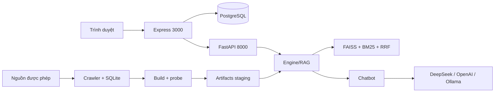

# ITLR–RAG | Intelligent IT Learning Platform

Nền tảng học CNTT tiếng Việt: tìm tài nguyên (khóa học, tài liệu), hỏi đáp RAG có trích dẫn
nguyên văn từ nguồn, theo dõi lộ trình và tiến độ, và các tính năng cộng đồng. Hệ thống gồm
giao diện Express/TypeScript/EJS (cổng 3000), backend FastAPI (cổng 8000) và PostgreSQL.

**Trạng thái phát hành: NO-GO cho production.** Staging single-host đã chạy thật (Docker,
PostgreSQL 16, Caddy TLS nội bộ, E5, Qwen2.5:3b, Chrome). Hai blocker còn mở: CPU-only
không đạt SLO 45 giây cho prompt uncached, và human faithfulness chưa có người chấm
(`null`). Chi tiết: [certification](reports/FINAL_E2E_CERTIFICATION.md) ·
[validation](reports/VALIDATION.md).

## Năng lực

- **Tìm kiếm lai**: FAISS inner-product trên embedding E5-base (768d), BM25, hợp nhất RRF,
  reranker CrossEncoder (bật mặc định, tắt bằng `DISABLE_RERANKER=1`); ngưỡng mặc định `min_pct=84`.
- **Chat có bằng chứng**: model chỉ chọn chunk ID (JSON), engine bind câu trả lời nguyên văn
  từ excerpt đã lưu (`llm_extractive`); citation được kiểm id và byte-verbatim; thiếu bằng
  chứng thì từ chối thay vì sinh claim tự do.
- **Nguồn và provenance**: crawler có robots/rate limit, kiểm giấy phép từng nguồn, lưu
  license/attribution; snapshot curated 118 trang thật trong repo.
- **Vòng đời index**: build staging → probe → activate nguyên tử → `/admin/reload` → rollback;
  fingerprint artifacts đã nạp hiển thị ở `/health`.
- **Ứng dụng Web**: tài khoản, hội thoại SSE, tiến độ khóa học, tài liệu đính kèm có kiểm
  chữ ký, diễn đàn, khu quản trị, CSRF, rate limit RAM, một worker/replica mỗi service.

## Kiến trúc



Chi tiết thành phần, ranh giới module và trade-off: [ARCHITECTURE](docs/ARCHITECTURE.md).
Luồng RAG, citation và fallback: [RAG](docs/RAG.md).

## Bắt đầu nhanh (local)

Yêu cầu: Python ≥3.11 (đã kiểm chứng với 3.14.4), Node.js 22, PostgreSQL, artifacts và
model cache đã chuẩn bị. Một checkout mới không tự có `var/`, model hay database.

```bash
python3 -m venv .venv
.venv/bin/python -m pip install -r requirements.txt
cd web && npm ci && cp .env.example .env
```

Điền `web/.env` (database, `JWT_SECRET` ≥32 ký tự, `ADMIN_PASSCODE` ≥16 ký tự,
`APP_ORIGIN`, `RECOMMENDER_URL`). Sau đó, từ `web/`:

```bash
npm run migrate
npm run seed      # cần var/data/web_items.csv
npm run dev
```

API chạy song song, không gọi provider trả phí nếu thiếu key:

```bash
env -u DEEPSEEK_API_KEY -u OPENAI_API_KEY \
  USE_OLLAMA=0 DISABLE_RERANKER=1 HF_HUB_OFFLINE=1 TRANSFORMERS_OFFLINE=1 \
  .venv/bin/python -m uvicorn itlr.api.server:app \
  --host 127.0.0.1 --port 8000 --workers 1 --no-proxy-headers
```

Migration/seed **ghi database**; chỉ chạy với database đích đã kiểm tra. Chuẩn bị dữ liệu,
build index và chạy với model local: [DEPLOY](deploy/DEPLOY.md),
[LOCAL_MODELS](deploy/LOCAL_MODELS.md). HTTPS/Compose một host: [PRODUCTION](deploy/PRODUCTION.md).

## Docker Compose (full stack)

Stack local gồm **Web (3000) + FastAPI RAG (8000) + PostgreSQL 16 + Ollama/Qwen2.5:3b**,
HTTP trên loopback. Production (TLS/Caddy/image bất biến) dùng
[compose.production.yml](compose.production.yml) theo [PRODUCTION](deploy/PRODUCTION.md).

Điều kiện: Docker Engine + Compose v2, ≥8 GB RAM (Qwen 3B + E5), ≥15 GB đĩa; lần chạy đầu cần
mạng để tải model. Kiểm tra: `docker --version && docker compose version`.

### Quick Start

```bash
cp .env.docker.example .env.docker          # rồi thay mọi REPLACE_* (xem dưới)
docker compose --env-file .env.docker -f compose.local.yml build
docker compose --env-file .env.docker -f compose.local.yml up -d postgres
docker compose --env-file .env.docker -f compose.local.yml run --rm --no-deps web node dist/db/migrate.js
docker compose --env-file .env.docker -f compose.local.yml run --rm --no-deps web node dist/db/sync-courses.js
docker compose --env-file .env.docker -f compose.local.yml up -d
docker compose --env-file .env.docker -f compose.local.yml exec ollama ollama pull qwen2.5:3b
```

Lệnh trên dùng `var/` hiện có (artifacts + `var/data/web_items.csv`). Máy mới chưa có dữ liệu:
làm mục **Dữ liệu và index** trước, rồi migrate/sync. Mở **http://localhost:3000**.

### 1. Cấu hình `.env.docker`

```bash
cp .env.docker.example .env.docker
# thay REPLACE_WITH_openssl_rand_hex_16 (2 lần), _32, _24 bằng secret thật, ví dụ:
#   openssl rand -hex 16   → POSTGRES_PASSWORD, ADMIN_PASSCODE
#   openssl rand -hex 32   → JWT_SECRET
#   openssl rand -hex 24   → ITLR_ADMIN_TOKEN
chmod 600 .env.docker
```

Không commit `.env.docker` (đã gitignore). `POSTGRES_PASSWORD` chỉ dùng ký tự hex để không phải
URL-encode trong `DATABASE_URL`; đổi mật khẩu sau khi volume đã tạo **không** tự đổi mật khẩu
PostgreSQL — xem mục Backup/restore.

### 2. Ollama: container (mặc định) hoặc host

- **Container (mặc định):** service `ollama`, model lưu trong volume `ollama_models`; tải bằng
  `docker compose ... exec ollama ollama pull qwen2.5:3b` (khoảng vài GB). API gọi
  `http://ollama:11434`.
- **Host Ollama (tiết kiệm RAM, dùng model đã có):** chạy Ollama bind cả interface
  (`OLLAMA_HOST=0.0.0.0:11434 ollama serve`; mặc định `127.0.0.1` sẽ bị container từ chối), rồi:

  ```bash
  docker compose --env-file .env.docker -f compose.local.yml -f compose.host-ollama.yml up -d
  ```

  Override đặt `OLLAMA_BASE_URL=http://host.docker.internal:11434` và `host-gateway` (Linux).
  Model phải có sẵn trên host (`ollama list` thấy `qwen2.5:3b`).

`OLLAMA_TIMEOUT` mặc định 240s cho local; đây **không** phải SLO production — cold prompt trên
CPU vẫn có thể vượt 45s ([certification §12](reports/FINAL_E2E_CERTIFICATION.md)).

### 3. Dữ liệu và index (máy mới)

Chỉ dùng nguồn thật trong `configs/collect.sources.json`; không tạo URL/nội dung giả. Crawl và
build chạy trong container API để dùng đúng dependencies:

```bash
dc() { docker compose --env-file .env.docker -f compose.local.yml "$@"; }
dc run --rm api python scripts/collect_data.py --sources help   # xem nguồn được phép
dc run --rm api python scripts/collect_data.py                  # ghi var/data/collect/crawl.db
dc run --rm api python scripts/build_all_v2.py --real-only      # staging → probe → activate
```

Lần đầu `build_all_v2` tải E5 vào `var/hf` (mount), cần mạng; các lần sau dùng cache. Probe fail
thì index cũ giữ nguyên. Nếu artifacts đã có trong `var/artifacts`, bỏ qua bước build; chỉ cần
reload khi vừa activate: `curl -X POST localhost:8000/admin/reload -H "X-Admin-Token: $ITLR_ADMIN_TOKEN"`.

Sau khi index đổi, đồng bộ catalog Web (nếu bỏ qua, bấm khóa học sẽ 404):

```bash
dc run --rm api python scripts/export_web_catalog.py --refresh
dc run --rm api python scripts/verify_web_catalog.py
```

### 4. PostgreSQL: migrate và nạp catalog

```bash
dc run --rm --no-deps web node dist/db/migrate.js        # schema.sql, idempotent
dc run --rm --no-deps web node dist/db/sync-courses.js   # upsert từ ITEMS_CSV, giữ enrollment
```

Không có `tsx` trong runtime image nên dùng `node dist/db/*.js`, không dùng `npm run migrate`.
`sync-courses` upsert theo `item_id`, **không xóa** khóa học/enrollment đang có.

### 5. Khởi động và kiểm tra

```bash
dc up -d
dc ps
curl -fsS http://127.0.0.1:8000/health        # engine ready, items, fingerprint artifacts
curl -fsS http://127.0.0.1:3000/health        # Web liveness
curl -fsS http://127.0.0.1:3000/ready         # PostgreSQL sẵn sàng
```

`/health` API chỉ đổi `artifacts.version/manifest_sha256` sau reload thành công. API healthcheck
có `start-period` 300s (nạp E5 lần đầu có thể lâu); Web chỉ khởi động khi PostgreSQL healthy và
API healthy.

### 6. Cập nhật dữ liệu

```bash
dc run --rm api python scripts/refresh_pipeline.py --force-build   # crawl → build/activate
dc run --rm api python scripts/export_web_catalog.py --refresh
dc run --rm api python scripts/verify_web_catalog.py
dc run --rm --no-deps web node dist/db/sync-courses.js
curl -fsS -X POST http://127.0.0.1:8000/admin/reload -H "X-Admin-Token: $ITLR_ADMIN_TOKEN"
```

`refresh_pipeline.py` tự export + verify sau build; thêm `--sync-web` (cần `DATABASE_URL` trong
container) để chạy `npm run sync` — mặc định tắt vì đây là bước ghi database.

### 7. Backup và restore

```bash
mkdir -p backups && umask 077
dc exec -T postgres pg_dump -U "$POSTGRES_USER" -d "$POSTGRES_DB" -Fc > "backups/db-$(date -u +%Y%m%dT%H%M%SZ).dump"
tar -czf "backups/var-$(date -u +%Y%m%dT%H%M%SZ).tgz" var
```

Restore vào **stack/DB mới** (không `pg_restore --clean` lên DB đang chạy): tạo database rỗng,
`pg_restore --exit-on-error`, rồi trỏ `DATABASE_URL` của Web vào DB đó và kiểm account/catalog.
Khôi phục `var/` (artifacts + `web_items.csv` + `hf`) vào checkout/staging riêng trước.

### 8. Dừng, khởi động lại, log

```bash
dc stop                         # giữ container + volume
dc restart api web              # sau khi đổi .env.docker
dc down                         # xóa container, GIỮ volume (pgdata, ollama_models)
dc logs -f --tail=200 web api
# TUYỆT ĐỐI không dùng `dc down -v` trừ khi chủ động xóa toàn bộ DB/model
```

### 9. Troubleshooting

| Hiện tượng | Nguyên nhân / cách sửa |
|---|---|
| Web exit: `Thiếu biến môi trường JWT_SECRET` / `ADMIN_PASSCODE` | `.env.docker` chưa thay `REPLACE_*`; JWT ≥32 ký tự, passcode ≥16; `dc logs web` |
| Web `DATABASE_URL phải dùng credentials riêng` | mật khẩu còn `postgres/password/changeme`; đổi `POSTGRES_PASSWORD`, tạo lại volume nếu DB đã khởi tạo |
| `/ready` 503 / `ECONNREFUSED postgres` | PostgreSQL chưa healthy hoặc sai host: trong Compose dùng `postgres:5432`, không `localhost`; `dc ps`, `dc logs postgres` |
| API 503, log `VersionError`/manifest | thiếu artifacts/probe hoặc manifest SHA sai: build/probe/activate lại; `ITLR_REQUIRE_ARTIFACT_MANIFEST=1` cố ý fail-closed |
| API 503 sau khi activate | chưa reload: `POST /admin/reload` với token, hoặc `dc restart api`; kiểm `artifacts` fingerprint |
| Bấm khóa học 404 | PostgreSQL chưa có item mới: `export_web_catalog.py --refresh` → `verify_web_catalog.py` → `sync-courses` |
| Thiếu embedding E5 / lỗi tải model | `var/hf` rỗng khi offline: bỏ `HF_HUB_OFFLINE`/`TRANSFORMERS_OFFLINE`, cho container tải lần đầu, hoặc mount cache có sẵn vào `/app/var/hf` |
| API không gọi được Ollama | trong Compose dùng `http://ollama:11434`; nếu Ollama ở host dùng `compose.host-ollama.yml`; kiểm `dc exec api python -c "import urllib.request;print(urllib.request.urlopen('http://ollama:11434/api/tags').status)"` |
| Cổng bị chiếm (3000/8000/5432/11434) | đổi `WEB_PORT`/`API_PORT`/`POSTGRES_PORT`/`OLLAMA_PORT` trong `.env.docker`; các cổng chỉ bind `127.0.0.1` |
| Qwen trả lời rất chậm/timeout | CPU-only prefill ~30–50s/prompt; tăng `OLLAMA_TIMEOUT` cho local, hoặc dùng hardware mạnh hơn |

## Cấu hình

Cấu hình Python đi qua `itlr/config.py` (paths) và biến môi trường của process; Web đọc
`web/.env` qua `web/src/config/env.ts`. Bảng biến đầy đủ và giá trị mặc định nằm ở
[DEPLOY §Cấu hình](deploy/DEPLOY.md#cấu-hình); không lặp lại trong README để tránh lệch.

Nguyên tắc: secrets chỉ trong môi trường hoặc file local bị gitignore; `.env.example`
chứa giá trị rỗng; không đưa key/reset token vào log hay báo cáo.

## Luồng công việc chính

1. **Nạp dữ liệu** — import snapshot curated hoặc crawl có kiểm soát → SQLite + metadata.
2. **Build/probe** — `scripts/build_all_v2.py --real-only --no-activate` tạo version mới trong
   staging, probe cấu trúc/dimension/NaN/self-retrieval, ghi `MANIFEST.json`.
3. **Activate/reload** — activate version đã probe, `POST /admin/reload` với `X-Admin-Token`;
   `/health` trả fingerprint `version` + `manifest_sha256` của engine đang phục vụ.
4. **Đồng bộ catalog Web** — `export_web_catalog.py --refresh` (merge, giữ row cộng đồng) →
   `verify_web_catalog.py` (mọi item RAG phải có row Web) → `npm run sync` (upsert, không xóa
   enrollment). Bỏ bước này thì bấm khóa học trong search/chat sẽ 404. Không có transaction
   xuyên Python/PostgreSQL.
5. **Rollback** — `versioning.rollback()` + reload; backup/restore PostgreSQL theo
   [PRODUCTION](deploy/PRODUCTION.md).

## Kiểm chứng

```bash
env -u DEEPSEEK_API_KEY -u OPENAI_API_KEY \
  USE_OLLAMA=0 DISABLE_RERANKER=1 OMP_NUM_THREADS=1 MKL_NUM_THREADS=1 OPENBLAS_NUM_THREADS=1 \
  .venv/bin/python -m pytest tests/ -o addopts='' -q -ra
.venv/bin/python -m compileall -q itlr scripts eval
.venv/bin/python -m pip check
cd web && npm run typecheck && npm run lint && npm run build && npm test
```

Kết quả mới nhất (máy Linux, commit `f14c428`, không thay đổi code runtime): **503 Python PASS/0 skip**, coverage
statements **67,63%**; **163 Web PASS**, line coverage **51,45%**; typecheck/lint/build,
compileall, pip check PASS; pip-audit **0**, npm audit **0**, Bandit **0 High**. Docker staging
fresh `--no-cache` + Chrome **11/11** PASS trong phạm vi single-host. Phương pháp, coverage và
giới hạn: [TESTING](docs/TESTING.md) · [EVALUATION](docs/EVALUATION.md).

## Triển khai

| Môi trường | Tài liệu |
|---|---|
| Local (dev, không Docker) | [DEPLOY](deploy/DEPLOY.md) |
| Local full stack Docker | [Docker Compose](#docker-compose-full-stack), [compose.local.yml](compose.local.yml) |
| Model E5/Qwen local | [LOCAL_MODELS](deploy/LOCAL_MODELS.md) |
| Single-host HTTPS (Caddy + Compose) | [PRODUCTION](deploy/PRODUCTION.md) |

Giới hạn hạ tầng hiện hành: một host Linux, local filesystem, một worker/replica mỗi
service; limiter/presence trong RAM và khóa file chưa hỗ trợ nhiều host. Restart container
không tự migrate/seed.

## Giới hạn đã biết

- **SLO 45s**: Qwen2.5:3b trên CPU này prefill 40–51s cho prompt 1387 token; nén prompt
  500/800 chars làm giảm chất lượng theo case nên default giữ `None`. Cần prefill
  ≥65–70 tok/s (CPU mới hoặc GPU) và phải chạy lại frozen + cold/warm.
- **Human faithfulness/entailment** chưa đo (`null`); packet và protocol chấm đã sẵn sàng.
- Capacity/soak dài, cold concurrency >1, multi-host/HA, migration production **chưa
  kiểm chứng**.
- Catalog legacy 5.000 items và interactions CF là **synthetic**; snapshot thật là 118 trang.
  Qrels hiện có là metadata/rule-based hoặc engineer-authored, không phải human panel.
- Citation hợp lệ/verbatim không chứng minh entailment; chỉ tiêu chưa đo phải `null`.
- Pickle chỉ nạp từ builder tin cậy; SHA256 không chống được attacker sửa cả file và manifest.
- Không gán giấy phép cho repository; giữ license/attribution từng nguồn theo
  [data README](data/README.md).

## Điều hướng tài liệu

| Nhu cầu | Tài liệu |
|---|---|
| Kiến trúc, ranh giới, trade-off | [docs/ARCHITECTURE.md](docs/ARCHITECTURE.md) |
| Truy hồi, generation, citation, fallback | [docs/RAG.md](docs/RAG.md) |
| HTTP API và route Web | [docs/API.md](docs/API.md) |
| Test, coverage, chiến lược kiểm chứng | [docs/TESTING.md](docs/TESTING.md) |
| Metric, dataset, nguồn nhãn, giới hạn | [docs/EVALUATION.md](docs/EVALUATION.md) |
| Bảo mật, trust boundary, scan | [docs/SECURITY.md](docs/SECURITY.md) |
| Quyết định kiến trúc | [ADR](docs/decisions/ADR-001-deepseek-primary-llm.md) (001–013) |
| Trạng thái & evidence mới nhất | [PROJECT_MEMORY](docs/PROJECT_MEMORY.md), [VALIDATION](reports/VALIDATION.md), [certification](reports/FINAL_E2E_CERTIFICATION.md), [code freeze](reports/FINAL_CODEBASE_FREEZE.md), [maintainability](reports/FINAL_MAINTAINABILITY_REVIEW.md), [pipeline audit](reports/PIPELINE_AUDIT_2026-10-31.md), [Docker local](reports/DOCKER_DEPLOYMENT_2026-10-31.md) |
| Quy ước cho coding agent | [AGENTS](AGENTS.md), [CONSTRAINTS](CONSTRAINTS.md) |
| Lịch sử thay đổi | [CHANGELOG](CHANGELOG.md) |
| Lưu trữ (không phải trạng thái hiện hành) | [reports/](reports/), [review 2026-10-27](docs/review-2026-10-27.md), [nghiên cứu nền 2026-10-27](RESEARCH_ITLR.md), [kế hoạch](tasks/plan.md) |
