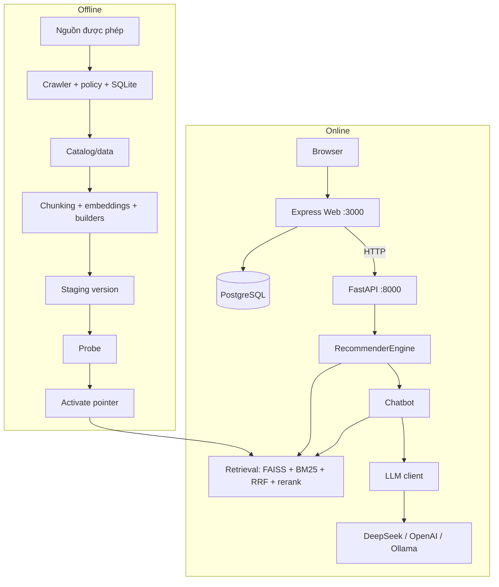
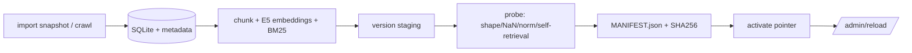

# Kiến trúc và ranh giới module

Tài liệu này là nguồn chuẩn cho kiến trúc hiện hành. Kết quả kiểm chứng nằm ở
[validation](../reports/VALIDATION.md) và [certification](../reports/FINAL_E2E_CERTIFICATION.md);
khả năng production phải được đánh giá riêng trên staging.

## 1. Thành phần và luồng dữ liệu

- **Web** sở hữu phiên người dùng, tài khoản, hội thoại, tiến độ, tệp đính kèm và trang quản
  trị. Web không truy cập artifacts hay model; mọi truy hồi/sinh văn bản đi qua API Python.
- **API** không phụ thuộc phiên Web hay SDK Web. Nó giữ engine RAG, rate limit theo IP và
  admin reload. API có thể chạy độc lập với Web cho mục đích đánh giá.
- **Offline pipeline** tạo artifacts; không chạy ngầm khi phục vụ request hay restart container.

## 2. Ranh giới module

| Khu vực | Sở hữu | Sửa khi |
|---|---|---|
| `web/src/app.ts` | middleware, view/static, ghép route | thay đổi wiring |
| `web/src/server.ts` | listening socket, signal, shutdown | thay đổi lifecycle process |
| `web/src/routes/` | auth, validation, orchestration HTTP, SSE | thay đổi endpoint/contract |
| `web/src/services/` | adapter chat, render, learning, social | thay đổi hành vi ứng dụng |
| `web/src/db/` | PostgreSQL, schema jobs, catalog upsert | thay đổi storage |
| `web/src/config/env.ts` | biến môi trường Web, kiểm secret bắt buộc | thay đổi cấu hình |
| `itlr/api/` | HTTP API, rate limit, fingerprint | thay đổi contract HTTP |
| `itlr/retrieval/` | retrieval service dùng chung, BM25, ngưỡng | thay đổi ranking/ngưỡng |
| `itlr/core/chunks.py` | FAISS chunk, RRF, CrossEncoder | thay đổi candidate/fusion/rerank |
| `itlr/core/` | item retrieval legacy (V2), primitive | duy trì tương thích V2 |
| `itlr/chatbot/` | intent, evidence, generation, citation | thay đổi orchestration trả lời |
| `itlr/chatbot/presentation.py` | template Markdown, tóm tắt catalog | thay đổi output template |
| `itlr/chatbot/llm_client.py` | transport provider, retry, usage | thay đổi tích hợp LLM |
| `itlr/chatbot/llm_adapter.py` | history, fallback/logging | thay đổi adaptation |
| `itlr/collect/`, `itlr/pipelines/` | ingestion, builder offline | thay đổi nguồn/build |
| `itlr/versioning.py`, `itlr/locking.py` | activate/history/rollback, khóa file | thay đổi lifecycle index |
| `itlr/config.py` | đường dẫn runtime | thay đổi path |
| `scripts/`, `eval/` | entrypoint vận hành/đánh giá | thêm lệnh/đo lường |
| `deploy/` | cấu hình và quy trình phát hành | thay đổi deployment |

Hướng phụ thuộc: Web → HTTP → API → engine → retrieval/chatbot. Retrieval không phụ thuộc
Web, PostgreSQL hay SDK provider. Transport provider chỉ nằm trong `llm_client.py`.

## 3. Trạng thái và tính nguyên tử

- **Artifacts**: staging version → probe → `CURRENT.json` pointer (atomic) + history mirror.
  Reload nạp engine mới trước khi hoán đổi; lỗi giữ engine cũ. Fingerprint `/health`
  (`version`, `manifest_sha256`) chỉ đổi sau reload thành công — đây là bằng chứng engine
  đang phục vụ, không phải nội dung `CURRENT.json`.
- **PostgreSQL**: schema là bản áp dụng một chiều (`schema.sql`), không phải framework
  migration có thể rollback. Backup trước thay đổi; rollback code không rollback dữ liệu.
- **Catalog Web** (`var/data/web_items.csv`) là file do Web append/sync; exporter từ chối ghi đè
  để không mất tài liệu cộng đồng. Không có transaction xuyên artifacts ↔ PostgreSQL ↔ CSV.
- **Khóa và rate limit** dùng file lock Linux và bộ đếm trong RAM: đúng cho một
  worker/replica mỗi service trên local filesystem, không phải cơ chế phân tán.

## 4. Online: retrieval → generation → citation

Luồng đầy đủ, ngưỡng và quy tắc citation: [RAG](RAG.md). Tóm tắt contract:

- Off-topic gate và intent xử lý trước khi gọi model; template trả lời không gọi provider.
- Chế độ mặc định `llm_extractive`: model trả JSON danh sách chunk ID; engine dựng câu trả
  lời từ excerpt đã lưu, gắn `evidence_binding="verbatim"`. Citation sai/không tồn tại bị loại.
- SSE phát `sources`, `meta`, `text` (provisional), `final`, `done`. Text provisional không phải
  kết quả đã kiểm; client/Web chỉ hoàn tất khi `final` + `done` và EOF sạch.
- Lỗi provider/thiếu bằng chứng trả `insufficient_evidence` hoặc error final, không tự chuyển
  sang cloud provider khác.

## 5. Offline: ingest → build → probe → activate

- `scripts/build_all_v2.py --real-only --no-activate` giữ version mới ngoài pointer.
- Probe kiểm kỹ thuật; không thay thế đánh giá chất lượng.
- `--with-cf` sinh interactions synthetic + CF; CF là tùy chọn, thiếu model trả 503 ở
  personas/for-you nhưng không ảnh hưởng search/chat.
- GC giữ version current/previous và staging chưa probe; không xóa thủ công khi job đang chạy.

## 6. Tương thích

- Giữ shim `itlr/core/bm25.py`: pickle cũ tham chiếu module này.
- Giữ contract V2/V3, schema PostgreSQL, đường dẫn pickle và SSE. Không đổi tên
  module/class được pickle tham chiếu nếu không có kế hoạch migration riêng.
- API sync (`/api/chat`, `client.chat/stream`) và async (`achat_stream`) cùng tồn tại;
  async là đường phục vụ SSE hiện hành.

## 7. Trace một request (handover)

Ví dụ người dùng gửi câu hỏi trong `/chat`:

1. `web/src/views/chat.ejs` + `public/chat*.js` gửi `POST /api/chat/stream` (cookie `token`, header CSRF).
2. `web/src/routes/api.routes.ts` → `requireAuth` → `chat.handlers.ts` `handleChatStream`.
3. Handler lấy history thuộc user (`services/chat-history.ts`), mở stream tới API qua
   `services/recommender.ts` (timeout/cancel) và parse frame bằng `services/chat-stream.ts`.
4. `itlr/api/server.py` `/api/chat/stream` → `engine.achat_stream`; retrieval ở
   `itlr/retrieval/service.py` + `itlr/core/chunks.py`; generation/citation ở `itlr/chatbot/`.
5. Chỉ khi `final` + `done` + EOF sạch, handler lưu hội thoại vào PostgreSQL và trả
   `response_html` đã render (`services/markdown.ts`).

Cho các luồng khác: `web/src/routes/*.routes.ts` → `services/*` → `db/pool.ts`; offline:
`scripts/collect_data.py` → `collect/` → `pipelines/` → `versioning.activate` → `/admin/reload`.

## 8. Trade-off đã chọn

| Quyết định | Lợi | Giá phải trả |
|---|---|---|
| Extractive binding thay vì freeform | câu trả lời byte-verbatim, không bịa passage | câu trả lời dài/nguyên khối, phụ thuộc chất lượng chunk |
| Một worker/replica + khóa local | đơn giản, ít thành phần | không scale ngang, không HA |
| Không transaction xuyên hệ thống | ít phức tạp vận hành | release cần maintenance window |
| Prompt budget mặc định `None` | giữ chất lượng theo case | prompt lớn, prefill chậm trên CPU |
| Reranker bật mặc định (`BAAI/bge-reranker-base`), tắt bằng `DISABLE_RERANKER=1` | ranking tốt hơn khi có model | thêm latency/RAM; cấu hình CPU thường tắt |

Các quyết định có bối cảnh/alternative: [ADR](decisions/ADR-001-deepseek-primary-llm.md)
(001–013). Giới hạn vận hành và gate phát hành: [PRODUCTION](../deploy/PRODUCTION.md).
