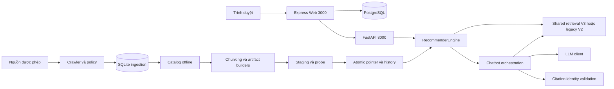

# Kiến trúc và ranh giới module

Tài liệu này mô tả code hiện hành. Kết quả kiểm chứng nằm trong
[validation](../reports/VALIDATION.md); khả năng production phải được đánh giá
riêng trên môi trường staging.

## Luồng online và offline

Web quản lý tài khoản, hội thoại và tiến độ bằng PostgreSQL. SQLite phục vụ
ingestion offline. Retrieval không phụ thuộc phiên người dùng Web hoặc SDK LLM.
Provider chỉ sinh câu trả lời từ evidence; ID citation hợp lệ chưa chứng minh
semantic faithfulness. SSE gửi text provisional, sau đó final thay thế kết quả.

## Lifecycle và compatibility

Build mới phải vào staging riêng, qua probe trước activation. Pointer/history
được cập nhật nguyên tử; reload nạp engine trước khi swap, lỗi giữ engine cũ.
Rollback quản lý version artifacts, không rollback schema hoặc dữ liệu PostgreSQL.
GC phải giữ staging đang chạy và các version cần cho rollback.

V2 và V3 tiếp tục dùng chung engine contract. Giữ shim `itlr/core/bm25.py` vì
pickle cũ tham chiếu module này. CF thiếu model trả 503 ở tính năng tương ứng;
retrieval vẫn độc lập. Mỗi service một worker/replica, filesystem Linux local;
khóa local và rate limiter RAM chưa cung cấp điều phối nhiều host.

## Bản đồ trách nhiệm

This map describes the current repository, including the deployment preparation
changes. It is a navigation guide, not evidence that all runtime paths have passed
production tests. See [ADR-010](decisions/ADR-010-shared-retrieval-and-atomic-state.md)
for the shared retrieval and artifact compatibility decisions.

| Area | Owns | Change here when |
|---|---|---|
| `web/src/app.ts` | Express middleware, view/static setup, route composition | Wiring middleware or routes |
| `web/src/server.ts` | Listening socket, OS signals, process shutdown | Changing process lifecycle |
| `web/src/routes/` | HTTP authorization, validation, response orchestration | Changing Web endpoints |
| `web/src/routes/chat.handlers.ts` | Chat validation, owned history, persistence and SSE lifecycle | Changing chat HTTP behavior; auth registration stays in API router |
| `web/src/services/` | Chat adapter, rendering, learning and social operations | Changing application behavior |
| `web/src/db/` | PostgreSQL access, schema jobs, catalog upsert | Changing storage operations |
| `web/src/config/` | Web environment and catalog paths | Changing Web configuration |
| `web/src/services/catalog-csv.ts` | Shared 10/16-column CSV whitelist and header reader | Changing append/sync catalog contracts |
| `itlr/api/` | Python HTTP API and rate limiting | Changing retrieval/chat HTTP contracts |
| `itlr/retrieval/` | Shared retrieval service and BM25 | Changing retrieval shared by search/chat |
| `itlr/core/chunks.py` | Chunk vectors, fusion, passage reranking | Changing chunk candidate/ranking behavior |
| `itlr/core/` | Legacy item retrieval and common engine primitives | Maintaining V2 compatibility |
| `itlr/core/display.py` | Catalog display text and safe link formatting | Changing display output without ranking changes |
| `itlr/chatbot/` | Intent, evidence, generation, citation checking | Changing answer orchestration |
| `itlr/chatbot/presentation.py` | Offline Markdown answers, catalog summaries and learning-path presentation | Changing template output without retrieval/provider changes |
| `itlr/chatbot/llm_client.py` | Provider calls, retries and generation usage | Changing LLM integration |
| `itlr/chatbot/llm_adapter.py` | Conversation history and provider fallback/logging adapters | Changing chatbot adaptation without transport changes |
| `itlr/collect/` | Collection policy, HTTP, parsing, SQLite ingestion | Changing source ingestion |
| `itlr/pipelines/` | Offline model/artifact builders | Changing reproducible build outputs |
| `itlr/config.py` | Python runtime paths | Changing artifact/data locations |
| `itlr/versioning.py`, `itlr/locking.py` | Activation, history, rollback and local locks | Changing index lifecycle |
| `scripts/`, `eval/` | Operational entrypoints and evaluation | Adding a command or measurement |
| `deploy/` | Operator configuration and release procedures | Changing runtime deployment |

Web routes call services/database operations; the recommender adapter crosses the
HTTP boundary to Python. Python retrieval must not depend on Web, PostgreSQL user
sessions or generation provider SDK calls. Generation consumes retrieved evidence;
provider transport stays in llm_client.py. Offline builders must not run implicitly
when serving a Web request or restarting a Web container.

The engine still supports legacy item artifacts alongside chunk artifacts. Keep
`itlr/core/bm25.py`: trusted historical pickles refer to that module path. Do not
rename persisted Python class/module paths without a separate migration plan.
Keep CF optional and generation replaceable without disabling retrieval.

The Web application factory is intentionally not introduced: one configured exported
Express app is sufficient. Importing app.ts does not open a listening socket, but
it still loads existing configuration/routes; this is not full dependency injection.
No repository/service/factory layers are added around existing single implementations.

The chatbot now delegates template presentation to a separate module while keeping
legacy helper imports available. See [ADR-011](decisions/ADR-011-chatbot-presentation-and-catalog-contract.md).
Large orchestration/engine files remain existing debt. Extract a responsibility only when
its callers and behavior can be isolated and verified; file length alone is not a
reason to move code. Subsequent work should preserve API/schema/artifact contracts
and proceed in small reviewable groups with regression evidence.

For the single-host stack, release jobs and known limits, use
[the production runbook](../deploy/PRODUCTION.md). New deployment/lifecycle behavior
is awaiting user verification.

Generation stream contract: the shared LLM client tolerates usage-only terminal chunks without completion choices; the public iterator still yields text only. [Verification](../reports/HARDENING_STREAM_2026-10-30.md).

Current hardening: non-stop provider finish reasons fail the text-generation contract;
Ollama malformed/error events and missing terminal completion raise LLMError. Web rejects
events after done. Partial tokens remain provisional; chatbot error final replaces them.
Provider selection happens before the call; template fallback does not imply automatic
cloud-provider failover. API startup may prewarm local Ollama as a lifecycle task; its
HTTP response is scoped by a context manager. Importing these modules does not start
that prewarm task (it runs from lifespan).

Release audit: API/Web `min_pct=90` maps to a raw dense cosine floor of 0.90;
V3 applies that floor before both dense and BM25 candidate truncation/RRF. This is
not a probability. The new real-snapshot release benchmark compares lexical search
with/without MMR, not E5/FAISS/CrossEncoder. No ranking/threshold change was justified.
API health currently exposes readiness/items/CF, not a loaded-version fingerprint.
See [release evidence](../reports/RELEASE_VALIDATION_2026-10-30.md).
