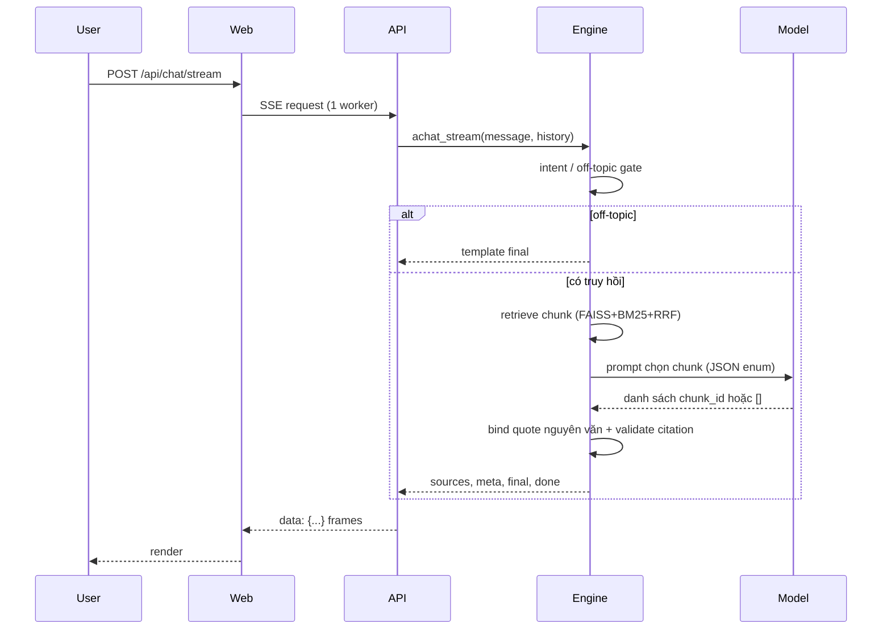

# RAG: truy hồi, sinh văn bản và citation

Tài liệu chuẩn cho pipeline RAG hiện hành. Số đo và trạng thái: [certification §11–§12](../reports/FINAL_E2E_CERTIFICATION.md).
Quyết định liên quan: [ADR-010](decisions/ADR-010-shared-retrieval-and-atomic-state.md),
[ADR-012](decisions/ADR-012-calibrated-search-and-stream-completion.md),
[ADR-013](decisions/ADR-013-evidence-excerpt-budget.md).

## 1. Thành phần

| Tầng | Hiện thực | Vai trò |
|---|---|---|
| Embedding | `intfloat/multilingual-e5-base` 768d, preset `query: ` cho query | vector dense, cosine qua inner product đã chuẩn hóa |
| ANN | FAISS `IndexFlatIP` | tìm dense trên toàn bộ chunk, chính xác (không xấp xỉ) |
| Lexical | Okapi BM25 (`k1=1.4`, `b=0.75`) trên `tokenize()` của recommender | bắt khớp từ khóa/identifier |
| Fusion | Reciprocal Rank Fusion, hằng số `60` | gộp dense + sparse không cần chuẩn hóa score |
| Rerank | `CrossEncoder` (`BAAI/bge-reranker-base`), bật mặc định; `DISABLE_RERANKER=1` để tắt | xếp lại top candidate theo cặp (query, chunk) |
| Generation | `llm_client` (DeepSeek mặc định, OpenAI hoặc Ollama) | chọn chunk / sinh template |
| Binding | engine | dựng câu trả lời nguyên văn từ excerpt đã lưu |

## 2. Offline: ingest → chunk → build

1. Nguồn: snapshot curated (`data/curated_resources.jsonl`, 118 trang thật) hoặc crawler có
   robots/rate limit và kiểm giấy phép từng domain. Metadata lưu `crawl_license`,
   `crawl_hash`, `source_fetched_at`; `full_text_allowed`/`listing_is_complete` phải là boolean.
2. Chunking: mỗi item sinh nhiều chunk text; `chunk_id = "<item_id>:<chunk_idx>"` là định
   danh mà model được phép chọn.
3. Embeddings + BM25: lưu `chunk_embeddings.pkl`, `chunk_meta.pkl`, FAISS index và
   `EMBEDDINGS_MANIFEST.json` (model, dimension, prefix).
4. Probe: kiểm số hàng/cột, NaN, norm, ID trùng, self-retrieval TF-IDF và nạp engine trong
   subprocess; ghi `MANIFEST.json`.
5. Activate: pointer `CURRENT.json` nguyên tử; engine chỉ đổi sau `/admin/reload` thành công.

Build lệnh: [DEPLOY §Chuẩn bị dữ liệu và index](../deploy/DEPLOY.md#chuẩn-bị-dữ-liệu-và-index).

## 3. Online: đường search

`POST /api/search` → `RetrievalService.search`:

1. Encode query (thêm `query: ` nếu preset E5) → vector 768d, chuẩn hóa L2.
2. Dense: FAISS trả điểm inner product (≈ cosine) cho mọi chunk; lọc `score × 100 >= min_pct`
   (mặc định **84**) **trước** khi cắt candidate.
3. Sparse: BM25 trên cùng tập được lọc.
4. RRF: mỗi ranking cộng `1 / (60 + rank)`; gộp theo chunk.
5. Cắt `candidate_k=32`, lấy `top_k=8`; tùy chọn unique theo item và reranker.
6. Trả metadata + `excerpt` + `chunk_id` + `score`; `min_pct` là ngưỡng cosine thang 0–100,
   không phải xác suất.

## 4. Online: đường chat

- **Off-topic gate** và intent chạy trước khi gọi model; câu ngoài phạm vi trả template, không
  tốn inference.
- **Chọn bằng chứng**: prompt liệt kê mọi chunk ứng viên (title, URL, excerpt); model trả
  **chỉ JSON array chunk ID** theo schema; câu trả lời không được model tự viết.
- **Binding**: engine dựng quote từ `excerpt` đã lưu, thêm `[item_id:…] [chunk_id:…]`; nội dung
  hiển thị vì vậy byte-verbatim với nguồn đã truy hồi.
- **Citation validation**: id phải nằm trong sources đã truy hồi, chunk id phải đúng
  `<item_id>:<idx>`, không malformed. `status=valid` + `evidence_binding=verbatim` là điều kiện
  của "accepted"; `semantic_grounding` luôn `not_verified`.
- **Refusal**: model trả `[]` hoặc bind thất bại → `insufficient_evidence` với
  `generation_error=no_selected_evidence`; không thay bằng câu trả lời suy đoán.

## 5. Provider và chế độ

| Cấu hình | Provider | Ghi chú |
|---|---|---|
| mặc định | DeepSeek (`DEEPSEEK_MODEL`, mặc định `deepseek-flash`) | cần key và quyền gọi |
| `OPENAI_API_KEY` | OpenAI-compatible | model/base URL override qua env |
| `USE_OLLAMA=1` | Ollama local (`OLLAMA_MODEL`, mặc định `qwen2.5:3b`) | không gọi cloud; timeout qua `OLLAMA_TIMEOUT` |
| `USE_OLLAMA=0` + không key | template/extractive | phải giữ đúng nhãn mode, không báo là LLM |

Provider được chọn lúc bắt đầu request; lỗi provider không tự failover sang cloud khác.
`llm_client` raise `LLMError` khi hết retry; adapter log rồi trả template/error final.

## 6. Fallback và lỗi

| Tình huống | Hành vi |
|---|---|
| Thiếu artifacts/model | `/health` 503; không phục vụ retrieval giả |
| CF thiếu `cf_model.pkl` | personas/for-you 503; search/chat không ảnh hưởng |
| Provider timeout/lỗi | final `generation_mode=insufficient_evidence` hoặc `error`, SSE `done` vẫn gửi |
| Citation không hợp lệ | câu trả lời không được accepted; không sửa id để "hợp lệ hóa" |
| Client disconnect | async transport đóng socket upstream, không sinh final thành công |
| Reranker lỗi | exception (không nuốt lỗi); tắt bằng `DISABLE_RERANKER=1` nếu chủ động |

## 7. Ngân sách prompt và latency

- `ITLR_EVIDENCE_EXCERPT_CHAR_BUDGET` giới hạn **prompt view** mỗi chunk (không cắt quote
  hiển thị). Mặc định `None` (đầy đủ); invalid/0 rơi về `None`.
- Đo trên prompt thật (4893 chars, 5 chunk, 1387 token) với Qwen2.5:3b CPU-only:
  prefill cold **40–51s** (27–34,5 tok/s), cache hit 0,14s. Nén 800 chars: 11/12 accepted
  nhưng mất `positive-12`; 500 chars: 10/12. Vì vậy default giữ `None`.
- **SLO 45s không đạt** trên hardware này; cần prefill ≥65–70 tok/s (CPU mới/GPU) và chạy lại
  frozen + cold/warm. Không nới SLO, không hạ model để hợp thức hóa PASS.

## 8. Tham số điều chỉnh

| Biến / tham số | Mặc định | Ý nghĩa |
|---|---|---|
| `min_pct` (API) | `84` | ngưỡng cosine tối thiểu, 0–100 |
| `top_k` / `candidate_k` | `8` / `32` | số kết quả trả về / số candidate sau RRF |
| `DISABLE_RERANKER` | không đặt = bật | đặt `1` để tắt CrossEncoder (cấu hình CPU/local) |
| `EMBEDDING_MODEL` | preset e5-base | đổi model phải rebuild artifacts |
| `ITLR_EVIDENCE_EXCERPT_CHAR_BUDGET` | `None` | giới hạn prompt view; xem ADR-013 |
| `OLLAMA_TIMEOUT` | `240` (legacy) | total generation deadline; phải hữu hạn |

## 9. Giới hạn

- Citation đúng id/verbatim **không** chứng minh entailment; human faithfulness `null`.
- Corpus thật hiện có 118 trang; catalog legacy 5.000 item là synthetic.
- Multi-hop và câu hỏi tiếng Việt phức tạp chưa được đánh giá đủ; bộ bổ sung 20 case
  (hard negative, multi-hop, injection) đã có nhưng chưa có người chấm.
- Prompt injection được chặn bằng system prompt + cấm follow instruction trong nguồn; chưa
  có red-team độc lập.
