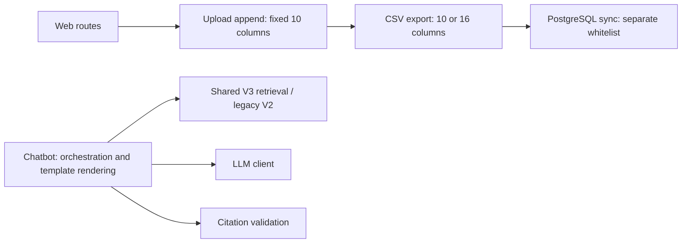
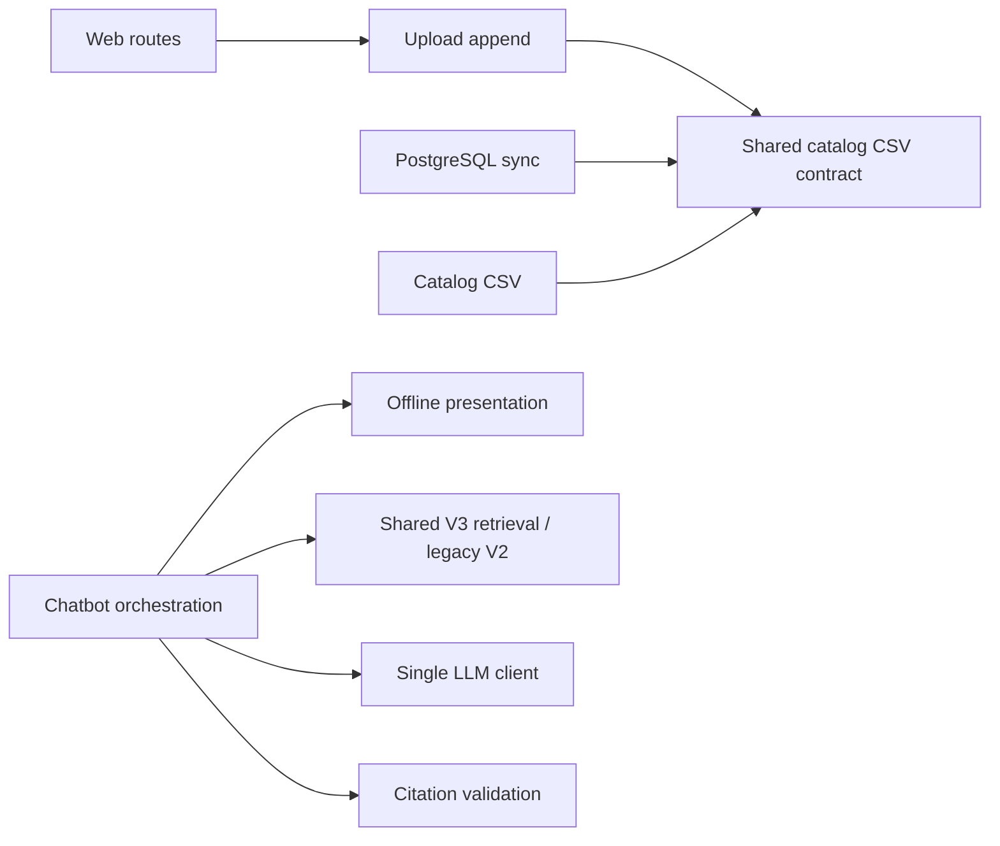

# Architecture audit and refactoring checkpoint

This is a verified increment, not completion of a whole-repository production
certification. Earlier uncommitted deployment/SSE changes were preserved. No new
dependencies, database migrations, artifact rebuilds/activation, paid calls, cloud
deployment, commits or pushes were performed in this increment.

## Scope and evidence

Read AGENTS, project memory, constraints, existing diffs and previous reports.
Used Ponytail Ultra for the smallest complete changes. Consulted the installed
Agent Skills for simplification, TDD, interfaces, review, debugging, security,
performance, Git, ADRs and constraints. CONSTRAINTS.md already exists and remains
unchanged; no new thresholds or test exclusions were introduced.

Parsed 85 Python modules across itlr/scripts/eval and 48 TypeScript modules at the
graph checkpoint, including tests. Artifacts: architecture_python_imports.json and
architecture_web_imports.json. The later app.test.ts adds a Web test module.
Static graphs are not a claim of reading every branch or resolving every dynamic
import. Manual inspection focused on chatbot/rendering, shared retrieval, ingestion
runner/store, lifecycle/config/locking, API health, Web upload/catalog sync,
Express composition, Docker/Compose and CI. Third-party dependency internals and
all authenticated user journeys were not exhaustively audited.

## Architecture before



## Architecture after



The end-to-end data path remains source policy -> crawler/HTTP -> SQLite ->
preprocessing/chunks -> embeddings/build -> probe/activate -> shared hybrid
retrieval/reranking -> generation -> citation identity validation -> Web.
The Web catalog export/sync branch populates PostgreSQL; it does not participate
in an atomic transaction with index activation. Evaluation remains separate from
serving and from independent human quality judgments.

## Resolved findings and changed modules

| Finding | Concrete change | Evidence |
|---|---|---|
| Presentation mixed into chatbot orchestration | Extract 27 existing definitions into presentation.py; retain helper imports in chatbot.py | Original AST bodies unchanged; 7 characterization tests pass before/after; 5 full Markdown fingerprints unchanged |
| 16-column catalog corrupted by 10-field upload append | Shared catalog-csv.ts whitelist/header reader; dataset.ts writes current column count; sync-courses.ts reuses it | RED: 2 failures; GREEN: all 3 catalog tests |
| Streaming fallback missing WARNING when console printing succeeds | Replace console/exception branch with existing logger; remove redundant print suppression in non-stream adapter | RED: 1 failure; GREEN: adapter and citation regressions |
| App composition hard to verify without process startup | Add actual HTTP liveness/readiness tests using exported app and a stub database | 2 tests PASS; no database/model connection |

chatbot.py shrank from 1516 to 951 lines; presentation.py is 595 lines. This is a
responsibility extraction, not a claim of reduced total code. No functionality,
compatibility shim or dependency was deleted. Removed duplicate CSV schema
ownership and redundant console/error branches. No abstraction layer was added.

## Verification

Baseline this increment: 21 focused Python tests PASS; Web typecheck and 70 tests
PASS. Baseline Web line coverage was 26.35% after the earlier app split.

Commands used with provider keys removed, USE_OLLAMA=0, offline model settings:

```text
.venv/Scripts/python.exe -m pytest tests/ -o addopts= -q -ra
.venv/Scripts/python.exe -m pytest tests/test_chatbot_presentation.py tests/test_chatbot_llm_adapter.py tests/test_grounded_citations.py tests/test_offtopic_gate.py tests/test_llm_client.py tests/test_chunks_v3.py tests/test_bm25_refit.py tests/test_collect_runner.py tests/test_collect_reconcile.py tests/test_collect_utils.py tests/test_curated_collection.py -o addopts= -q -ra
.venv/Scripts/python.exe -m compileall -q itlr scripts eval
.venv/Scripts/python.exe -m bandit -r itlr scripts -lll -f json -o reports/architecture_bandit.json
.venv/Scripts/python.exe -m pip check
cd web
npm run typecheck
npm run lint
npm run build
npm test
```

| Gate | Current result |
|---|---|
| Focused Python regression selection | PASS: 90 tests, one sandbox cache permission warning |
| Full Python suite | FAIL: 4 collection errors because Windows lacks fcntl; architecture_full_pytest.log |
| Python compilation | PASS |
| Bandit high severity gate | PASS; lower-severity findings retained in architecture_bandit.json |
| pip dependency consistency | PASS |
| Web typecheck, lint, build | PASS; lint retains 20 existing warnings |
| Full Web suite | PASS: 75 tests in 17 files; line coverage 35.42%, baseline 26.35%; includes catalog and app HTTP contracts |
| Current remote dependency advisory re-scan | NOT RUN in this increment; earlier scan results remain historical |
| Real PostgreSQL COPY/authenticated browser E2E | NOT RUN; tests use synthetic files/stub database |
| Docker/HTTPS/cloud/restore drill | NOT RUN; no Docker/Google Cloud environment available |
| Neural RAG quality/DeepSeek | NOT RUN; no paid calls or model downloads |

## Measured performance

architecture_template_benchmark.json compares HEAD's original synthesize_answer
with the extracted implementation: 3 synthetic items, 5 modes, 100 repetitions
per mode per variant, interleaved execution in one Windows/Python3.12 process.
Outputs match byte-for-byte. Before p95=3.654 ms, after p95=3.662 ms; p50 is about
0.129 ms for both. This is template rendering only. No speedup, retrieval-quality
improvement, HTTP latency SLO or statistical significance is claimed.

## Remaining findings and blockers

- No top-level Python or static Web import cycles found within graph scope.
  A function-local config/versioning/locking cycle remains; it is not evidence
  of a failing circular import. Lifecycle changes need Linux regression coverage.
- EducationalChatbot still owns intent-specific response orchestration and the
  legacy engine remains large. Further extraction needs separate contracts; not
  every long function was rewritten or every unused symbol proven removable.
- Upload callers still append asynchronously; ID allocation is now serialized within the process and recomputed from the file for each write. Multi-worker coordination still needs a shared sequence/lock.
  SQL writes, CSV export and index activation are not a shared transaction.
  Stop cooperating writers during the documented release/rollback procedure.
- Deployment configuration is prepared, not executed. API non-root runtime,
  immutable image pinning, backup restore drill, alert delivery and production
  load/quality evaluation remain release gates.
- Full suite is not green on this host. No fcntl shim, skip, test deletion,
  suppression or weakened quality gate was added to hide that limitation.

Rollback can restore the three independently reviewable groups: presentation
extraction, CSV contract fix, and logger cleanup, keeping unrelated earlier edits.
No persisted-data migration is needed for these changes.
