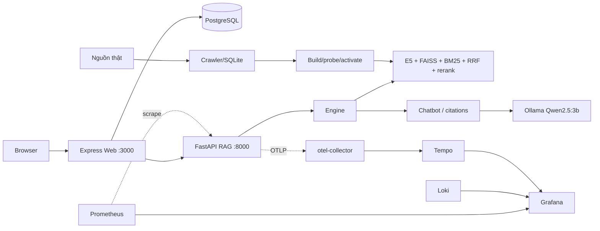

# Final engineering review — ITLR–RAG, 2026-10-31

**Verdict tách biệt: LOCAL READY / DEMO READY (scoped) / PRODUCTION NO-GO.** Code, Docker
local full-stack, RAG dữ liệu thật và observability đã chạy thực tế trên máy này. Production vẫn
bị chặn bởi cold SLO 45s (49,80s trên CPU) và human faithfulness chưa có người chấm.

## 1. Kiến trúc cuối cùng



Boundaries giữ nguyên: Web → HTTP → API → engine → retrieval/chatbot; provider SDK chỉ trong
`llm_client`; batch pipeline tách khỏi serving. Observability là sidecar/profile, không nằm
trong đường request.

## 2. Thay đổi của vòng cuối

| Nhóm | Thay đổi | Lý do |
|---|---|---|
| Metrics API | `itlr/observability/metrics.py`; `/metrics/prometheus`; instrument middleware, search, chat/SSE, artifact version | Prometheus chuẩn, label cardinality thấp, không log prompt |
| Tracing | `itlr/observability/tracing.py` (OTLP opt-in), span `http.request`, `retrieval.search`, `generation.chat`, `sse.chat`, `crawler.run`, `crawler.pipeline`, `index.build` | Theo dõi request + pipeline mà không ảnh hưởng khi tắt |
| Web metrics | `web/src/services/metrics.ts`, `/metrics`, middleware, SSE outcome counter | Metric Web + bảo vệ token/loopback |
| Monitoring stack | `compose.monitoring.yml` + `deploy/monitoring/*` (Prometheus, Grafana, Loki, Tempo, otel-collector, cAdvisor, node-exporter, postgres-exporter, promtail), dashboard 13 panel, 10 alert | Profile opt-in, retention/volume/security |
| Docker | `compose.local.yml`, `compose.host-ollama.yml`, `.env.docker.example`, Dockerfile CPU torch | Full stack local + Windows/Ubuntu |
| Pipeline | export `--refresh`, verify catalog, audit link, max-id, refresh tích hợp | Sửa 404 gốc, dữ liệu thật |
| Docs | README Docker/monitoring/Windows, ARCHITECTURE trace, SECURITY/TESTING/EVALUATION | Đồng bộ code |

Commit đã đẩy trước đó: `e763d5f` (pipeline + Docker). Vòng này (observability) **chưa commit**.

## 3. Lỗi sửa và bằng chứng RED → GREEN

| Lỗi | Root cause | RED | GREEN |
|---|---|---|---|
| Prometheus không có dữ liệu LLM/SSE/citation | tên Counter Prometheus có hậu tố `_total` nhưng dashboard/alert dùng tên gốc | query `sum(itlr_sse_streams)` trả `no-data` | sửa `_total`; query trả 1; alert rules reload 10 |
| API metrics không scrape được từ container | endpoint chỉ nhận `X-Admin-Token` | Prometheus target cần token | thêm `Authorization: Bearer`; target `itlr-api` **up** |
| Không có trace cho SSE | chỉ sync chat có span | trace SSE không có `sse.chat` | rebuild API; trace có `sse.chat` |
| Crawler/index không trace | batch scripts không init | không có span batch | thêm `crawler.run`/`index.build` (no-op khi tắt) |
| Host Ollama không truy cập từ container | daemon bind `127.0.0.1` | container `connection refused` | docs yêu cầu `OLLAMA_HOST=0.0.0.0`; test dùng container Ollama + model mount |
| Course 404 | PostgreSQL chưa sync sau build | `/courses/5129` 404 | export+sync → 200 |

Test mới: 5 Python observability + 3 Web metrics (+2 mailer từ lượt trước). Không skip, không hạ
gate.

## 4. Test results (lượt cuối)

| Gate | Kết quả |
|---|---|
| Python pytest | **510 passed / 0 skip**, ~56s |
| Python coverage | **4109/6019 = 68,27%** |
| Web vitest | **166 passed / 32 file** |
| Web coverage | lines **52,41%**; statements 49,23%; branches 40,45% |
| typecheck / lint / build / compileall / pip check | PASS |
| pip-audit / npm audit / Bandit | 0 / 0 / 0 High |
| Secret scan / `git diff --check` | 0 hit / PASS |
| Docker compose config (base, host override, monitoring) | PASS |
| Prometheus promtool check + 10 alert rules; Loki/Tempo verify; OTel validate; promtail syntax | PASS |

## 5. Xác minh runtime (Docker + Qwen + monitoring)

| Hạng mục | Kết quả |
|---|---|
| 13 container stack (4 app + 9 monitoring) | tất cả **up/healthy** (trừ Loki/Tempo/Tempo readiness tạm 503 lúc khởi động, sau 200) |
| Prometheus targets | 5/5 **up** (api, web, cadvisor, node, postgres) |
| API metrics | không token **403**, bearer **200**; có `itlr_http_requests_total`, `itlr_artifact_info` item 178 |
| Web metrics | bearer **200** |
| Traffic thật | search 200; chat SSE `sources→meta→text→final→done`, `llm_extractive` |
| Prometheus metric sau traffic | LLM count 1, SSE 1, citation 1, generation 1 |
| Tempo | trace `POST /api/chat/stream` có spans `http.request`, `sse.chat`, `fastapi.*` |
| Loki | log container `itlr-local-api-1` truy vấn được (`{service="api"}`) |
| Grafana | health 200; dashboard `itlr-rag` 13 panel; 3 datasources |
| Alerts | 2 group / **10 rules** |
| Overhead monitoring | **~383 MiB RAM**, ~15–20% CPU lúc scrape (9 container) |
| Shutdown | dừng sạch, ports đóng, **volume giữ** (pgdata, prom, grafana, loki, tempo, ollama) |

## 6. Đã kiểm chứng / NOT VERIFIED

- **Ubuntu:** đã chạy thực tế (Docker 29.9.2) — PASS.
- **Windows 11:** chỉ có hướng dẫn WSL2; **NOT VERIFIED** trên máy Windows thật.
- `ollama pull` model mới trong container: **NOT VERIFIED** (test dùng model host mount).
- Public TLS/ACME/production compose: **NOT RE-RUN** (evidence staging cũ).
- Full 178-link audit: mới mẫu 6 link (PASS).
- Cold SLO 45s: **FAIL** (49,80s); human faithfulness **NOT VERIFIED**.
- High cardinality/soak dài của monitoring: chưa soak; retention đã giới hạn.

## 7. Rủi ro và giới hạn

1. Cold prompt >45s trên CPU → cần hardware mạnh hơn/GPU; không nới SLO.
2. Human evaluation chưa có; mọi metric dashboard là runtime, không phải faithfulness.
3. cAdvisor `privileged` và promtail đọc `docker.sock` — cần thiết cho container/log metrics;
   tắt nếu chính sách bảo mật không cho phép (README).
4. Prometheus/Grafana dùng token/mật khẩu local; không có SSO/HA; single-host.
5. observability dùng thêm ~383 MiB; trên laptop 8 GB vẫn khả thi nhưng nên bật khi debug.
6. Trace chỉ bật khi đặt `OTEL_EXPORTER_OTLP_ENDPOINT`; không có span thì không ảnh hưởng serving.

## 8. Khởi động và kiểm tra cuối

```bash
# stack + monitoring (sau khi đã có .env.docker, model, artifacts, DB)
docker compose --env-file .env.docker -f compose.local.yml -f compose.monitoring.yml --profile monitoring up -d
curl -fsS localhost:8000/health        # items + artifact version
curl -fsS localhost:3000/ready         # PostgreSQL
curl -fsS localhost:9090/-/healthy     # Prometheus
curl -fsS localhost:3001/api/health    # Grafana
# sinh traffic rồi mở dashboard http://localhost:3001 (admin / GRAFANA_ADMIN_PASSWORD)
docker compose ... stop                # giữ volume; không dùng down -v
```

## 9. Verdict

- **LOCAL READY** — code sạch trong phạm vi kiểm chứng, full stack Docker chạy được, RAG dữ
  liệu thật, monitoring/profile hoạt động, gates xanh.
- **DEMO READY (scoped)** — demo single-host với dữ liệu thật; cần cảnh báo cold latency ~50s
  và không cam kết SLA.
- **PRODUCTION READY: NO-GO** — cold SLO 45s và human faithfulness chưa đạt; chưa có HA/soak/
  Windows verification.

---

## (Historical) Final engineering review — ITLR–RAG, 2026-10-30


**Verdict: NO-GO cho production.** Retrieval có cải thiện đo được; correctness và
resource boundaries được sửa bằng regression. Chưa có PostgreSQL/Docker/HTTPS
staging, independent generation labels hoặc soak/capacity evidence để chứng nhận
production-grade. Không diễn giải citation hợp lệ thành faithfulness.

## Baseline, phạm vi và quyền

Kế thừa [full-system audit](FULL_SYSTEM_AUDIT_2026-10-30.md) và inventory/evidence:
**431 Python PASS/0 skip, 132 Web PASS**, coverage **66,13% / 45,31%**. HEAD vẫn
`01703e9`; working tree đã chứa sửa/báo cáo từ phiên audit trước. Không ghi đè chúng,
không trình bày lại bảy sửa trước như sửa mới của review này.

Linux x86_64, Python 3.14.4, Node 22.22.1/npm 9.2.0, i7-8650U 4 cores/8 threads,
RAM 15.221 MiB. Ollama 0.40.13, Qwen2.5 3B Q4_K_M, 4096 context, CPU/0 VRAM;
E5-base 768d cùng cache/revision đã kiểm ở audit trước. Tải và chạy thêm **reranker
đã được cấu hình trong repo** `BAAI/bge-reranker-base` từ Hugging Face chính thức;
không đổi embedding/generation model. Inference qua SentenceTransformers/Ollama
local; cloud credentials bị unset. Không gọi cloud/paid inference.

Chỉ dùng artifacts **118 real snapshots / 1576 chunks** ở
`/tmp/itlr-system-audit/staging`. Không activation, CURRENT pointer change,
production migration/seed, xóa dữ liệu, commit hoặc push. Re-pickle tests chỉ ghi
temporary fixtures. Mọi số PASS dưới đây là các lần chạy mới trong continuation.

Skills áp dụng: Ponytail, agent-skills debugging/TDD/performance optimization,
security, code review, code simplification, git workflow, documentation/ADRs và
browser verification. Chọn sửa nhỏ có bằng chứng, không thêm dependency ứng dụng,
DI hierarchy hoặc refactor theo số dòng.

## Root causes và RED → GREEN

| Finding | Root cause / impact | Reproduction → fix → verification |
|---|---|---|
| P1 retrieval floor | `min_pct=90` là cosine 0,90, loại positives trước cả dense/BM25/RRF; không phải “90% confidence” | Default regression FAIL; dev sweep chọn 0,84, giữ explicit overrides. API/engine/Web cùng default 84; UI slider không còn ép tối thiểu 85 hoặc quảng cáo 90–100% cho mọi relevant item. |
| P1 query drift | Engine luôn dùng text lowercased/stripped punctuation, và append topics khi câu chỉ nhắc một concept. Một câu xin session token biến thành query tài liệu Token | Glossary regression FAIL; sau đó raw-text regression 1 FAIL/1 PASS. Chỉ expand bare aliases và chỉ dùng corrected text khi có correction/abbreviation thật. Không thêm denylist riêng cho test query. |
| P1 final-before-completion | Server/browser consumer nhận final rồi EOF vẫn coi là hoàn tất; handler lưu DB ngay khi gặp final, dù upstream sau đó lỗi | 3 Web regressions FAIL → PASS. Require final/done và parsing hoàn tất; forward sources/tokens sớm, giữ final pending rồi mới save/emit final+done. UTF-8 fixture được bổ sung done đúng contract, giữ nguyên assertions và kiểm byte fragmentation. |
| P2 Web/API limits | Web nhận message tới 12.000 chars trong khi FastAPI chỉ 2.000; owned history có thể chứa assistant text >4000 hoặc empty legacy messages | 4 regressions FAIL → PASS. Limit Web/input 2000; chỉ cắt context copy, không sửa DB; bỏ empty context, tránh cắt giữa surrogate pair. Ownership/transactions giữ nguyên. |
| P1 JSON serialization | Real pandas catalog có NaN metadata; source contract đã sanitize nhưng recommendations/meta vẫn trả raw item. Live `/api/chat` 500 | 4 regressions FAIL → PASS cho final/generate × chat/stream. Tách/reuse `citations.public_item`: non-finite → null, bỏ internal full snapshot body; áp dụng cho recommendations và early meta. API thật sau sửa chat/SSE 200 với `generation_mode=llm`. |
| P2 continuous-token timeout | urllib read timeout được reset bởi dữ liệu tiếp tục đến, nên 533,73 s stream không vi phạm read timeout | Continuous-token regression FAIL → PASS. Check monotonic elapsed budget mỗi NDJSON event, close response/raise LLMError; không đổi finish-reason/citation validation. Live budget 2 s: lỗi budget sau 2,14 s, không cloud fallback. |
| P1 persistence safety | Re-pickle mở original bằng `wb` trước khi dump; disk/write failure làm mất nội dung. Mismatch sklearn bị ignore rồi restamp | 2 fixture regressions FAIL → PASS. Write temp cùng directory, flush/fsync, giữ mode, atomic replace; cleanup own temp, trả exit 1 khi lỗi/mismatch. Không chạy utility trên runtime artifacts. |
| P2 hidden compatibility warning | `runtime_patches` blanket-ignore `InconsistentVersionWarning` | Warning-observability regression FAIL → PASS; bỏ filter/version-restamping rationale. Engine vẫn đọc legacy pickle, warning không còn bị che; không coi re-save là model migration an toàn. |

Tổng cộng thêm **14 Python tests**, **8 Web tests** so với baseline 431/132.
Không thêm skip/xfail, giảm coverage gate, bỏ assertion hoặc suppress scanner finding.
Một negative ở engine holdout đã thất bại trong lượt trung gian; log và kết quả đó
được giữ. Không dùng raw retrieval PASS để che engine query-rewrite failure.
Live NaN failure được quan sát ở tool trace; failing server log ban đầu bị rerun ghi
đè, nên `runtime-boundary-red.log` là RED evidence được giữ cho lỗi serialization.

## Retrieval: dataset, calibration và kết quả

Corpus giữ nguyên `data/curated_resources.jsonl`, E5 `query:`/`passage:` và L2
normalization, FAISS + BM25 + RRF/candidate pool hiện có. Không đổi weights/RRF k,
embedding model, active index hoặc chatbot gate **0,80**.

- `engineering_queries.jsonl`: **36** frozen cases, dev/holdout mỗi bên 12 positives
  English/Vietnamese + 6 negatives, **6 source items mỗi split**, không overlap.
- Dev sweep 0,70–0,90; chọn **0,84** chỉ bằng dev, yêu cầu negative rejection và
  precision judged/nDCG không giảm so với baseline. Sau đó evaluate holdout.
- `engineering_confirmation_queries.jsonl`: **22** cases trên **8 source items khác**,
  16 positives + 6 negatives. Freeze trước chạy confirmation; không tune thêm floor.
- `release_queries.jsonl`: 23 cases lịch sử, gồm Vietnamese/English/typo/multistep và
  2 unanswerable. Không đổi labels để nâng điểm.

Các nhãn là **engineer-authored**, quotes kiểm bằng exact membership trong snapshot,
không phải independent human panel và chưa exhaustive. Holdout được dùng để tìm lỗi
pipeline rồi kiểm lại; không quảng cáo đây là pristine blind test sau debugging.
Confirmation cũng là engineering evidence, không thay external acceptance set.
Precision bên dưới chỉ trên judged items; unjudged items có thể relevant. Metrics
positive-query và negative empty-result rate được ghi riêng.

### Raw shared retrieval: đối chiếu trực tiếp con số 4,76%

Cùng 23 queries, model/corpus và RRF, không query rewrite/reranker:

| Cosine floor | Recall@5 | Precision judged@5 | MRR@5 | nDCG@5 | Recall@10 | p50/p95/p99 ms |
|---|---:|---:|---:|---:|---:|---|
| 0,90 | 0,0476 | 0,0095 | 0,0476 | 0,0476 | 0,0476 | 62,87 / 96,76 / 105,83 |
| 0,84 | **0,9286** | **0,2000** | **0,6063** | **0,6775** | **0,9286** | 56,53 / 66,74 / 67,73 |

Cả hai loại 2/2 negatives. Đây là lý do hạ default có bằng chứng, không phải đổi
weights hoặc tháo off-topic gate. Một run/variant, không phải load benchmark/SLO.

### Actual engine search: query understanding + retrieval

Before dùng `RecommenderEngine` từ Git HEAD với cùng loaded model/artifacts; after
dùng code hiện hành. Baseline API/engine có rewrite nên không dùng 4,76% raw như
baseline end-to-end. Chạy serial; latency gồm encoding/rewriting/retrieval.

| Split | Version | Recall@5 | Precision judged@5 | MRR@5 | nDCG@5 | Negative empty |
|---|---|---:|---:|---:|---:|---:|
| Dev | Before | 0 | 0 | 0 | 0 | 6/6 |
| Dev | After | 0,8333 | 0,1667 | 0,7250 | 0,7515 | 6/6 |
| Holdout | Before | 0 | 0 | 0 | 0 | 6/6 |
| Holdout | After | **0,8333** | **0,1667** | **0,7083** | **0,7411** | **6/6** |
| Confirmation | Before | 0 | 0 | 0 | 0 | 6/6 |
| Confirmation | After | **0,6250** | **0,1250** | **0,5781** | **0,5894** | **6/6** |
| Release | Before | 0,0952 | 0,0190 | 0,0952 | 0,0952 | 2/2 |
| Release | After | 0,9286 | 0,2000 | 0,5825 | 0,6599 | 2/2 |

After p50/p95/p99: holdout **60,48/75,70/80,56 ms**, confirmation
**63,50/95,76/120,71 ms**, release **61,68/79,67/84,89 ms**. Whole benchmark process
peak RSS **1772,15 MiB**; không gồm Ollama server. Không tuyên bố latency cải thiện
có ý nghĩa thống kê, multi-user capacity hoặc không giảm precision trên mọi corpus.

### Reranker thật

BAAI/bge-reranker-base, max_length 512, candidate pool 32, cùng selected floor 0,84:

| Raw split | Variant | Recall@5 | Precision judged@5 | MRR@5 | nDCG@5 | p95 ms |
|---|---|---:|---:|---:|---:|---:|
| Dev | E5 + BM25/RRF | 0,8333 | 0,1667 | 0,7250 | 0,7515 | 61,33 |
| Dev | + reranker | 0,8333 | 0,1667 | 0,8333 | 0,8333 | 853,47 |
| Holdout | E5 + BM25/RRF | 0,7500 | 0,1500 | 0,7083 | 0,7192 | 62,70 |
| Holdout | + reranker | 0,7500 | 0,1500 | 0,7083 | 0,7192 | 405,60 |

Negatives 6/6 bị loại cả hai split. Whole process E5+reranker peak **2565,28 MiB**.
Reranker không cải thiện holdout này, nên không đổi weights, pool hoặc thêm policy
bắt buộc rerank. Existing optional reranker configuration được giữ; model cache mới
không phải artifact activation. Model card ưu tiên English/Chinese; không suy ra
Vietnamese quality từ tên model hoặc chỉ từ dev score.

## Local LLM: profile, sửa an toàn và các thử nghiệm không được đưa vào runtime

Chỉ `qwen2.5:3b`, fixed E5 768d. Prompt Docker cũ **5562 chars, 1295 input tokens**,
không có bằng chứng context overflow trong sample đó với context 4096. Output budget
2000 và việc model chép metadata/đoạn trích, lặp và không stop có thể tạo stream rất
dài; read timeout đơn thuần không giới hạn elapsed time khi token vẫn đến.

Profile có terminal `prompt_eval_count`, `eval_count`, durations, TTFT và raw answer:

- Cùng prompt/seed 42, temperature 0,3 so với 0,0, cap 256: 0,3 có 3/4 stop,
  0,0 chỉ 1/4 stop. Lower temperature **không** giải quyết loop; không thay default.
- Cold/warm prefix cache tác động lớn tới TTFT: khoảng 0,14 s khi cached so với
  29–38 s khi phải prefill. Thread comparison cũng đổi cache/load state, nên không
  dùng nó để kết luận thread tuning thắng hoặc đưa num_thread mới vào runtime.
- Candidate prompt ít context/metadata hơn, yêu cầu trả lời ngắn, cap 384: 4/4 stop,
  khoảng 22,5–30,0 s nhưng 1/4 citation malformed và có SQL example không đáng tin
  cậy. **Không đưa candidate vào runtime** và không sửa validator để làm PASS.
- Reuse transport payload builder cho chat/stream; thêm elapsed budget check tại
  mỗi NDJSON event. Live long-generation fault test: **2 s → LLMError sau 2,14 s**,
  2 deltas provisional, không nhận partial làm complete hoặc retry sang cloud.

Budget check chạy khi event đến. Blocking read đang stall vẫn do read timeout quản
lý; chưa phải hard wall-clock cancellation ở mọi trạng thái. Character trimming
vẫn là xấp xỉ token; pathological Unicode/history context chưa có tokenizer-exact
admission proof. Không tăng num_ctx hoặc đổi output budget chỉ để giấu truncation.

### Live API sau sửa JSON boundary

Uvicorn 127.0.0.1:18080, strict real-staging manifest, Qwen thật, reranker disabled,
`OLLAMA_TIMEOUT=60` cho smoke này:

| Gate | Outcome |
|---|---|
| Health/search/default threshold | 200; ready, 118 items, CF=false |
| CF chưa build / admin chưa cấu hình | 503 / 403 đúng contract |
| HTTP404 question non-stream | **6,06 s**, `generation_mode=llm`, citation valid |
| Cùng câu qua SSE | **6,04 s**, đúng một final + done, mode llm/citation valid |
| Shutdown | Listening socket đóng, process dừng; vẫn có loky semaphore warning sau SIGTERM |

Ollama runner RSS quan sát sau các phép thử: **2481880 KiB ≈ 2423,71 MiB**,
không phải per-request peak. Không còn named semaphore của hai audit servers đã
dừng tại thời điểm kiểm `/dev/shm`; quan sát này không thay soak/leak test.

Đây là câu khác ca 533,73 s và khác budget/cache state; **không gọi đây là benchmark
89× speedup**. Citation identity valid không đo semantic entailment. `faithfulness`,
`hallucination_rate`, independent usefulness/refusal accuracy giữ **null**.

Source inspection cho thấy Uvicorn re-raises captured SIGTERM sau graceful shutdown;
loky đăng ký semaphore cleanup qua finalizers/resource_tracker. Direct model/threaded
reload probes trước đó không tái hiện warning, và không thấy temp server còn chạy.
Đây là diagnosis có giới hạn, chưa có soak proof hoặc dependency-level fix; không
suppress warning hay monkeypatch third-party signal handling.

## Clean architecture / files changed

| Area | Change và lý do |
|---|---|
| `itlr/retrieval/service.py`, `engine.py`, `api/server.py` | Search default dùng chung trong Python; preserve raw intent/explicit override; không đổi artifact loading hoặc query vector model |
| `chatbot/llm_client.py` | Một request-payload builder dùng hai mode; elapsed budget/error/resource cleanup ở transport owner |
| `chatbot/chatbot.py`, `citations.py` | Bỏ category/prefix/formatting work và private ctx fields không có consumer; public metadata sanitizer dùng chung |
| `utils/runtime_patches.py`, `utils/repickle.py` | Warning visibility, atomic per-file rewrite, compatible version policy, meaningful process exit |
| Web recommender/pages/search view | Default đồng bộ 84; cosine label đúng, không thêm API setting endpoint/config hierarchy |
| Web chat handlers/history/stream/client/views | Pending final, confirmed completion, context-only bounds và input maxlength đồng bộ |
| Tests + eval JSONL | Regressions, raw query/override guards, source-disjoint evidence checks; không sửa release labels |
| README/architecture/deployment/memory/changelog/validation/ADR-012 | Ghi behavior hiện tại, migration/default caveats, PASS/FAIL/BLOCKED đúng scope |

AGENTS/CONSTRAINTS chỉ cập nhật checkpoint và số baseline đo mới; không nới test,
coverage/security gate hoặc quyền thực thi. Ngưỡng coverage đề xuất 60% giữ nguyên.

Preparation parity trên greeting/template/generation context: **PASS** cho consumed
outputs trước/sau cleanup, trước khi sửa JSON boundary. Giữ compatibility re-exports,
BM25 pickle shim, legacy CLI/module paths và schema. Không xóa opencode compatibility
entrypoint chỉ vì không có application caller; không gọi nó trong phép thử.

Static inventory **89 Python / 59 TypeScript files** trong itlr/scripts/eval/web/src,
gồm TypeScript tests, không gồm toàn bộ Python tests. Exact top-level function-body
scan không có duplicate source candidate >8 dòng; đây không phải proof không còn
duplication/dynamic coupling. Chatbot hiện **915 dòng**; không split theo số dòng khi
chỉ di chuyển complexity. Existing presentation/services boundaries được giữ.
Không mass-add annotations, wrappers, abstractions hoặc đổi tên để làm đẹp.

## Quality gates chạy cuối

| Gate | Baseline trước continuation | Final |
|---|---|---|
| Full Python | 431 PASS / 0 skip | **445 PASS / 0 skip, 52,12 s** |
| Python statements | 3713/5615 = 66,13% | **3755/5630 = 66,70%** |
| Full Web | 132 PASS, 25 files | **140 PASS, 25 files** |
| Web lines | 614/1355 = 45,31% | **634/1364 = 46,48%** |
| typecheck / lint / build | PASS trước đó | **PASS** |
| compileall / pip check | PASS trước đó | **PASS** |
| Online pip-audit | Không dùng kết quả cũ làm run mới | **105 distributions, 0 skipped, 0 advisories** |
| Online npm audit | Không dùng kết quả cũ làm run mới | **0 vulnerabilities** |
| Bandit itlr/scripts | 0 High / 27 Medium / 47 Low | **FAIL scanner: 0 High / 27 Medium / 46 Low**, exit 1 |
| Browser Chrome | Public forms audit trước | **PASS**: 390/1280px login/register; real JS runtime rejects missing done, preserves valid sequence, no HTML/script-URL injection |
| DB-backed authenticated Web journeys | PostgreSQL không có | **BLOCKED**, mocks không thay PostgreSQL integration |
| Docker/HTTPS/backup restore | Daemon permission denied | **BLOCKED**; không sửa system groups/permissions để vượt gate |
| Capacity/memory leak/independent generation quality | Chưa đủ setup/labels | **NOT MEASURED**, không suy ra từ smoke |

Một rerun Vitest trong sandbox lỗi listen EPERM (120 pass/20 chưa chạy); đã chạy
ngoài sandbox đủ 140 PASS, không skip source hoặc tăng hook timeout. Vite CommonJS
config warning còn, không đổi module system hoặc suppress để làm log đẹp.
Dependencies/lockfile ứng dụng không đổi; `npm ci --ignore-scripts` là evidence của
full-system baseline, không gọi reinstall cũ là run mới. Tooling venv tạm được reuse.

## Security: triage 74 → 73 findings

Một Low biến mất do xóa block che sklearn warning, **không thêm nosec**. Từng finding
còn lại có file/line/rationale trong `bandit-triage.json`:

- **22 Medium B301:** trusted builder pickle only; ACL/hash/probe trước runtime
  unpickle. Integrity không xác thực tác giả nếu attacker sửa được cả manifest.
- **5 Medium B310:** operator-configured HTTP(S) provider/probe URLs. Không có
  URL request-user truyền trực tiếp vào các call này; egress/redirect/host policy
  vẫn cần operator boundary. Crawler public-URL/DNS/rebinding caveats giữ nguyên.
- **19 Low B311:** synthetic/eval RNG và crawler jitter, không dùng cho auth.
- **9 B403 + 6 B404 + 6 B603 Low:** imports hoặc argument-list subprocess,
  không shell=True; executable/env cần operator-controlled trust.
- **4 B110 + 2 B112 Low:** best-effort console/model/Windows diagnostics hoặc
  malformed optional structured-data extraction; không nuốt lỗi generation/retrieval.

Đây là conditional risk acceptance, không phải 73 vulnerabilities đã bị xóa.
Auth/ownership/CSRF/XSS/upload/SQL parameterization và artifact rollback/concurrency
fixtures nằm trong full suites. Không đổi rate limits, roles, PostgreSQL schema,
artifact activation/history hoặc crawler source permissions. Single worker/local
Linux limitation giữ nguyên. Runtime re-pickle vẫn chỉ dành cho trusted offline
copies, cần probe mới trước activation; không phải đường migration production.

## Tái lập và vận hành

```bash
env -u DEEPSEEK_API_KEY -u OPENAI_API_KEY USE_OLLAMA=0 DISABLE_RERANKER=1 \
  OMP_NUM_THREADS=1 MKL_NUM_THREADS=1 OPENBLAS_NUM_THREADS=1 \
  .venv/bin/python -m pytest tests/ -o addopts='' -q -ra
.venv/bin/python -m compileall -q itlr scripts eval
.venv/bin/python -m pip check
cd web
npm run typecheck
npm run lint
npm run build
npm test
npm audit
```

Các harness đã chạy được giữ trong [evidence](final-engineering-evidence), dùng
workspace `/home/o/ITLR--RAG`, staging và audit tooling ở `/tmp`; không phải CLI
portable. Máy khác cần chỉnh đường dẫn và chuẩn bị trusted staging/model caches,
không chạy builder/migration mặc định vào dữ liệu đang phục vụ. `calibrate.py` ghi
selection từ dev trước khi evaluate holdout; không thay frozen labels.

Các nguồn bằng chứng chính:

- [Full Python](final-engineering-evidence/final-python.log),
  [coverage](final-engineering-evidence/python-coverage.json),
  [full Web](final-engineering-evidence/web-tests-outside.log).
- [Dev threshold selection](final-engineering-evidence/threshold-selection.json),
  [raw paired retrieval](final-engineering-evidence/raw-release.json),
  [paired engine search](final-engineering-evidence/runtime-search.json),
  [real reranker](final-engineering-evidence/calibration.json).
- [Live budget](final-engineering-evidence/live-budget.json),
  [API outcomes](final-engineering-evidence/live-api.json),
  [rejected prompt candidate](final-engineering-evidence/prompt-experiment.json),
  [browser checks](final-engineering-evidence/browser.json).
- [Bandit triage](final-engineering-evidence/bandit-triage.json),
  [pip audit](final-engineering-evidence/pip-audit.json),
  [npm audit](final-engineering-evidence/npm-audit.json),
  [static inventory](final-engineering-evidence/structure.json).

Local serving dùng [local-model runbook](../deploy/LOCAL_MODELS.md), cloud keys unset,
`USE_OLLAMA=1`, `OLLAMA_MODEL=qwen2.5:3b`, endpoint 127.0.0.1:11434 và E5 cache.
Search default mới 84 là behavior change có chủ đích; caller cần floor cũ truyền
90. Real legacy V2 quality chưa được đo lại; compatibility fixtures/pickle paths
PASS không thay benchmark trên legacy corpus thật.

Nguồn đã đối chiếu: [E5 model card](https://huggingface.co/intfloat/multilingual-e5-base),
[BGE reranker](https://huggingface.co/BAAI/bge-reranker-base),
[Ollama API](https://docs.ollama.com/api/chat),
[sklearn persistence/version compatibility](https://scikit-learn.org/stable/model_persistence.html).

## Remaining blockers / handoff

1. PostgreSQL tạm thật + register/login/ownership/history/progress/upload/SSE browser
   journeys; schema migration acceptance chỉ trên isolated DB.
2. Docker daemon access/HTTPS staging, image/volume/network/shutdown tests,
   activation/rollback và backup/restore/recovery drill dưới quyền operator.
3. Independent passage/human generation labels, off-topic acceptance dataset rộng
   hơn, tokenizer-exact context admission và hard cancellation trên blocking I/O.
4. Capacity/soak, p95/p99 generation nhiều mẫu, resource leak assessment và semaphore
   warning dưới target dependency/runtime environment.

Không có claim repository đã sạch toàn bộ dead code, production-ready hoặc model
không hallucinate. Không commit/push; mọi sửa và bằng chứng còn reviewable trong
working tree. Không để API/Web audit servers chạy nền sau bàn giao.
