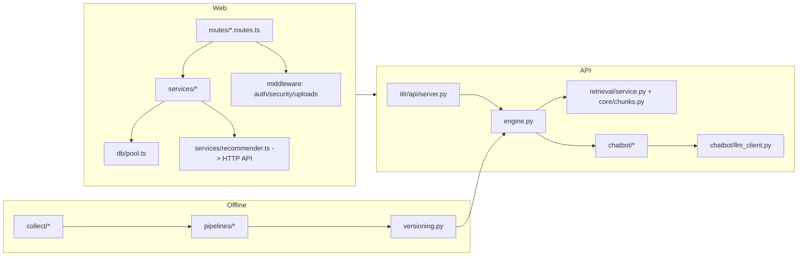

# FINAL MAINTAINABILITY REVIEW — ITLR–RAG (2026-10-31)

| Mục | Giá trị |
|---|---|
| Branch / HEAD | `main` @ `cd58edd`; working tree chưa commit (theo yêu cầu) |
| Baseline | 494 Python PASS / 160 Web PASS (trước lượt này) |
| Phạm vi | chỉ refactor bảo toàn hành vi + 1 test mới; không đổi API/schema/model/ranking |
| Report | tài liệu này; gates và evidence ở `reports/FINAL_CODEBASE_FREEZE.md` |

## 1. Dependency map (hiện hành)

Hướng phụ thuộc giữ nguyên: Web → HTTP → API → engine → retrieval/chatbot; provider SDK chỉ
trong `llm_client`. Offline pipeline không chạy khi serve request.

## 2. Phân loại trước khi sửa

| Hạng | Hạng mục | Quyết định |
|---|---|---|
| MUST FIX | `itlr/api/server.py` tự lặp lại default model + base URL + kiểm scheme của Ollama (đã có trong `llm_client`) | **Đã sửa** |
| MUST FIX | `itlr/api/server.py` lặp mapping history ở 2 endpoint chat | **Đã sửa** (helper `_history_payload`) |
| MUST FIX | `web/src/routes/auth.routes.ts` tự định nghĩa lại "SMTP đã cấu hình" trong khi `services/mailer.ts` đã có | **Đã sửa** (một hàm `isMailConfigured()` đọc env tại thời điểm gọi) |
| SHOULD FIX (defer) | Route files lớn: `social.routes.ts` 444, `api.routes.ts` 397, `admin.routes.ts` 367, `auth.routes.ts` 353 dòng | **KEEP** — mỗi file theo một resource; tách sẽ đổi import/app wiring và test mount, lợi ích đọc không tương xứng rủi ro |
| SHOULD FIX (defer) | `chatbot.py` 991, `recommender.py` 884 dòng | **KEEP** — AGENTS: không tách chỉ vì độ dài; `recommender` là legacy pickle surface |
| SHOULD FIX (defer) | `parseInt + isNaN` lặp ở route | **KEEP** — cosmetic, sửa sẽ tạo diff rộng không tăng testability |
| KEEP | `safeSourceUrl` ở TS server và `public/chat-stream.js` | Hai runtime khác nhau, không chia sẻ module |
| KEEP | 39 cảnh báo pyflakes | re-export compat (pickle/legacy), import side-effect, `# noqa` có chủ ý |
| KEEP | `itlr/core/bm25.py` shim | pickle cũ tham chiếu module |
| KEEP | `web/src/routes/*.test.ts` mount router trực tiếp | pattern hiện có, ổn định |

## 3. Thay đổi của lượt này

| File | Thay đổi | Lý do |
|---|---|---|
| `itlr/api/server.py` | Pre-warm Ollama lấy `base_url("ollama")` + `default_model("ollama")` từ `llm_client`; thêm `_history_payload` dùng cho `/api/chat` và `/api/chat/stream` | một nguồn cấu hình provider; bỏ 2 chỗ lặp |
| `web/src/services/mailer.ts` | Thêm `isMailConfigured()` (đọc env lúc gọi); `mailConfigured` giữ cho transporter | một nguồn rule SMTP |
| `web/src/routes/auth.routes.ts` | Dùng `isMailConfigured()`, xóa hàm local; import từ mailer | bỏ duplicate |
| `web/src/services/mailer.test.ts` *(mới)* | 2 test: chưa cấu hình → false + không gửi; đọc env lúc gọi | khóa hành vi mới |
| 3 test route | mock thêm `isMailConfigured` | khớp interface |
| `docs/ARCHITECTURE.md` | Thêm §7 "Trace một request" (UI → route → service → API → engine → DB) | onboarding/handover |
| README/AGENTS/CONSTRAINTS/TESTING/VALIDATION | 160 → 162 Web test | đồng bộ số liệu |

Không đổi: API contract, schema, migration, auth/authorization, business rules, SSE, citation,
RAG algorithm/model/prompt/ranking/threshold, artifact paths, dependency.

## 4. Kết quả kiểm thử

| Gate | Kết quả | Trạng thái |
|---|---|---|
| Python pytest | **494 passed / 0 skip**, 73,83s | PASS |
| Python coverage | **67,63%** (3949/5839) | PASS |
| compileall / pip check | PASS | PASS |
| Web vitest | **162 passed / 30 file** | PASS (+2 test mới) |
| Web coverage | lines **724/1408 = 51,42%**; statements 48,28%; branches 39,66% | PASS (không giảm) |
| typecheck (kể cả `--noUnusedLocals --noUnusedParameters`) | PASS | PASS |
| ESLint / build | PASS | PASS |
| npm audit / pip-audit / Bandit | 0 / 0 / 0 High | PASS |
| Secret scan / `git diff --check` | 0 hit / PASS | PASS |
| PostgreSQL16, Docker, Chrome, frozen RAG | không chạy lại (refactor không chạm các đường đó) | NOT RE-RUN (evidence trước) |
| Cold SLO 45s / human faithfulness | 49,80s / `null` | **FAIL / NOT VERIFIED** |

## 5. Trước / sau

| Chỉ số | Trước | Sau |
|---|---|---|
| Python test | 494 | **494** |
| Web test | 160 | **162** (+2) |
| Python coverage | 67,63% | **67,63%** |
| Web lines coverage | 51,42% | **51,42%** |
| Đoạn code trùng đã bỏ | — | 3 (provider defaults, history mapping, SMTP rule) |
| Dependency / schema / API change | — | **0** |
| File xóa | — | **0** |
| `tsc` unused symbols | 0 | **0** |

Không xóa test nào; không đổi kỳ vọng test để lấy PASS; test mới chỉ bổ sung.

## 6. Handover notes

- Điểm bắt đầu đọc: `docs/ARCHITECTURE.md` §1 (thành phần), §7 (trace request),
  `docs/RAG.md` (retrieval → citation), `docs/API.md` (contract).
- Nguồn cấu hình duy nhất: `itlr/config.py` (paths), `itlr/chatbot/llm_client.py`
  (provider defaults/base URL), `web/src/config/env.ts` (Web env), `deploy/DEPLOY.md` (bảng env).
- Chỗ dễ sửa sai: `web/src/routes/auth.routes.ts` (token/reset flow), `itlr/versioning.py`
  (atomic pointer), `itlr/core/chunks.py` (RRF/rerank) — đọc ADR-010/012/013 trước khi đổi.
- Đừng "dọn" các re-export trong `chatbot.py`, `recommender.py`, `collect/__init__.py`,
  `eval/__init__.py`: chúng giữ compatibility cho pickle/import cũ.

## 7. Verdict

- **CODE FREEZE READY** — refactor bảo toàn hành vi, giảm 3 điểm trùng lặp, test tăng
  (162 Web), coverage không giảm, không phát hiện regression.
- **PRODUCTION NO-GO** — giữ nguyên blocker: cold SLO 45s (49,80s) và human faithfulness
  (`null`). Không tuyên bố production-ready.
